<p align="center">
  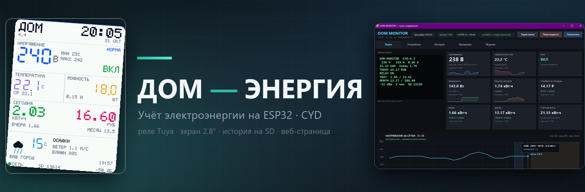
</p>

<h1 align="center">Дом — энергия 🏠⚡</h1>

<p align="center">
  <strong>Учёт электроэнергии на ESP32-2432S028 (CYD)</strong><br>
  Реле Tuya · экран 2.8" · история на SD · веб-страница · программа для Windows
</p>

<p align="center">
  
  
  
  
</p>

<p align="center">
  <a href="#-возможности"><b>Возможности</b></a> ·
  <a href="#-скриншоты"><b>Скриншоты</b></a> ·
  <a href="#-установка"><b>Установка</b></a> ·
  <a href="#-программа-для-windows"><b>Программа для Windows</b></a> ·
  <a href="#-home-assistant-mqtt-и-автообнаружение"><b>Home Assistant</b></a> ·
  <a href="#-все-команды"><b>Команды</b></a> ·
  <a href="#-все-http-эндпоинты"><b>HTTP</b></a> ·
  <a href="#-лицензия"><b>Лицензия</b></a>
</p>

> Это не «умный дом» на сто устройств и не облачный сервис. Одна плата,
> одно реле, одна карта памяти. Всё, что нужно для учёта, работает локально;
> интернет — только для мощности из облака Tuya и погоды.

---

## 🖼 Скриншоты

Экраны платы 2.8" и веб-страница — сняты с реального устройства.

<table>
<tr>
<td width="33%">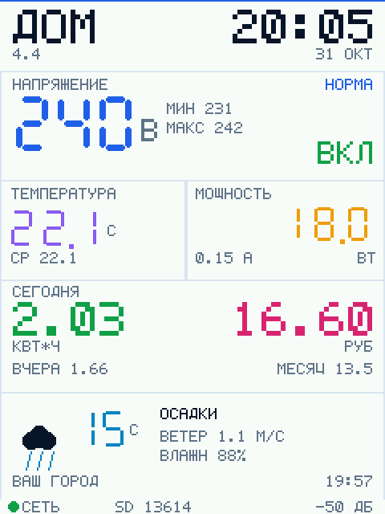<br><sub><b>Главный экран</b><br>напряжение, мощность, расход</sub></td>
<td width="33%">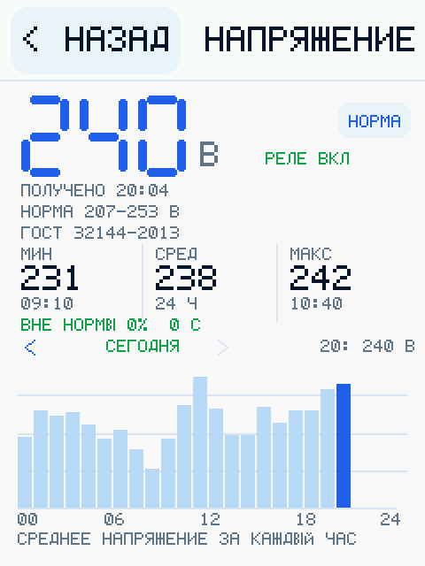<br><sub><b>Напряжение за сутки</b><br>график и подписи времени</sub></td>
<td width="33%">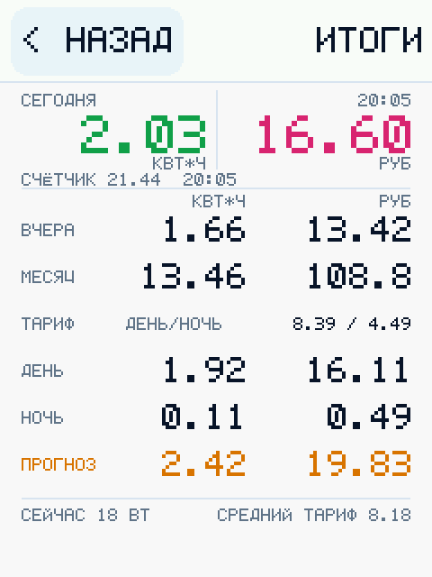<br><sub><b>Итоги</b><br>день, месяц, стоимость</sub></td>
</tr>
</table>

**Веб-страница с телефона:**

<p align="center">
  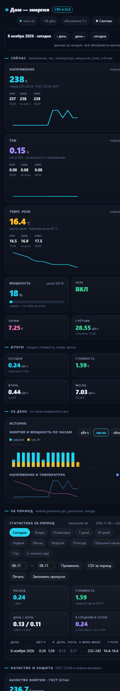
</p>

Все экраны и окна — ниже, с подписями: [🖥 Экран платы и рабочий процесс](#-экран-платы-и-рабочий-процесс).

---

## 📑 Содержание

- [🖼 Скриншоты](#-скриншоты)
- [💡 Что это и зачем](#-что-это-и-зачем)
- [🔌 Из чего состоит](#-из-чего-состоит)
- [⚡ Возможности](#-возможности)
- [📐 Как это работает](#-как-это-работает)
- [🖥 Экран платы и рабочий процесс](#-экран-платы-и-рабочий-процесс)
- [🔆 Экран, светодиод и динамик](#-экран-светодиод-и-динамик)
- [🎛 Все команды](#-все-команды)
- [🌐 Все HTTP-эндпоинты](#-все-http-эндпоинты)
- [🔧 Установка](#-установка)
- [💻 Программа для Windows](#-программа-для-windows)
- [☁ Восстановление истории из облака](#-восстановление-истории-из-облака)
- [🔒 Какие данные публикуются, а какие нет](#-какие-данные-публикуются-а-какие-нет)
- [🚀 Быстрый старт](#-быстрый-старт)
- [📁 Структура репозитория](#-структура-репозитория)
- [✅ Тесты](#-тесты)
- [⚠ Ограничения](#-ограничения)
- [👤 Разработчик](#-разработчик)
- [🤝 Как помочь проекту](#-как-помочь-проекту)
- [📄 Лицензия](#-лицензия)

---

## 💡 Что это и зачем

Домашний счётчик показывает только «сколько накрутило». Не видно, **когда**
был скачок напряжения, **сколько** реально потребляет чайник или перфоратор,
**какая** температура у реле и **сколько** это стоит по дневному/ночному
тарифу.

Этот проект закрывает именно эти вопросы:

- реле Tuya измеряет напряжение, ток и накопленную энергию;
- плата раз в 15–30 секунд забирает показания и раскладывает их по часам;
- история пишется на microSD и не пропадает при отключении интернета;
- на экране — пять окон с графиками и итогами;
- в браузере — та же история, но с нормальными графиками и подсказками.

Проект вырос из практики: несколько недель ушло на протокол Tuya, «застывшую»
мощность, порядок строк в CSV и тачскрин. Все грабли собраны в
[PITFALLS.md](docs/PITFALLS.md) — если что-то не работает, начинать оттуда.

---

## 🔌 Из чего состоит

| Компонент | Что именно | Примечание |
|---|---|---|
| Плата | **ESP32-2432S028** (CYD) | ESP32-D0WD-V3, 4 МБ flash, экран ILI9341 2.8" 240×320, тач XPT2046, слот microSD |
| Реле | Tuya Wi-Fi реле напряжения | измеряет напряжение/ток/энергию; **не входит** в репозиторий |
| Карта | microSD, FAT32, 8–32 ГБ | история `/energy.csv` |
| Питание | USB 5 В, 1 А | кабель с передачей данных |
| Wi-Fi | 2,4 ГГц | ESP32 не умеет 5 ГГц |
| ПК | Windows, опционально | бэкапы, архив прошивок, GUI |

**Схема подключения:** всё уже на одной плате. Внешних проводов нет —
только USB-питание и карта microSD. Реле подключается **не проводом**, а по
Wi-Fi (TCP 6668).

### Где купить

| Что | Где | Ссылка |
|---|---|---|
| **Плата с экраном** — ESP32 + TFT 2.8" + тач + microSD | AliExpress | [TENSTAR ESP32 с дисплеем 2.8"](https://aliexpress.ru/item/1005007280879338.html) |
| **Та же плата** | Ozon | [ESP32-2432S028](https://ozon.ru/t/LCmnIGD) |
| **Корпус под экран** | AliExpress | [корпус для CYD](https://ali.click/c6g2p14) |
| **Умное реле напряжения, тока и утечки тока с WiFi на DIN рейку с дисплеем** | Ozon | [Tuya умное реле (автомат) на DIN-рейку](https://ozon.ru/t/3QthrpD) |
| Карта microSD 8–32 ГБ | любой магазин | класс 10, FAT32 |

> **Важно при покупке платы.** Нужна именно **ESP32-2432S028** (её называют CYD —
> «Cheap Yellow Display») с **резистивным тачскрином** и **слотом microSD**.
> Встречаются похожие платы без слота карты или с ёмкостным экраном — они
> не подойдут без правки прошивки.
>
> **Про реле.** Подойдёт Tuya-реле с измерением мощности (DP `phase_a` —
> напряжение, ток, накопленная энергия). Дешёвые реле без замера мощности
> покажут только состояние ВКЛ/ВЫКЛ и энергию не посчитают.

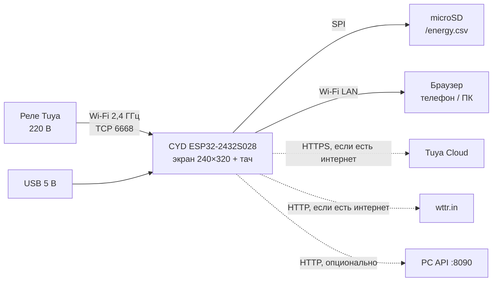

Подробная распиновка — [docs/WIRING.md](docs/WIRING.md). Отдельная схема
пайки не нужна: это моноблок, все соединения уже разведены на заводе.

---

## ⚡ Возможности

- **Главный экран и пять окон** — напряжение, температура, мощность, итоги,
  погода. Всего шесть экранов; переключение — касанием карточки.
- **История на microSD** — строка раз в 30 секунд, ~2880 строк в сутки,
  автоматическая ротация по месяцам (`/energy-YYYY-MM.csv`).
- **Графики по часам за любой день** — до 60 дней назад, с мин/сред/макс,
  пиками мощности и «вне нормы».
- **Пики мощности — когда случился и сколько длился**: на экране
  `ПИК 1117 ВТ / 16:53  3 МИН`, на веб-странице «пик 642 Вт в 14:51,
  длился 9 мин».
- **Веб-страница** — адаптивная, с графиками, подсказками при наведении и
  листанием дней; работает с телефона и компьютера.
- **Управление подсветкой** — выключение на ночь (`DISP OFF`), яркость 0–100 %,
  пробуждение касанием на 20 секунд. Настройка живёт в памяти платы.
- **Светодиодная индикация состояния** — шесть цветов: сеть, реле, карта,
  интернет, погашенный экран, загрузка. Видно с другого конца комнаты.
- **Звуковые сигналы на динамик** — тревога при выходе напряжения за
  207–253 В и при перегреве реле выше 55 °C, писк при касании.
- **Работа без интернета** — локальное реле, экран и запись на карту
  продолжают работать; пропадают только облачная мощность и погода.
- **Дозаполнение истории из облака** — если плата стояла, пропущенные часы
  можно восстановить (команда `CSVHIST` или автоматически).
- **Бэкапы** — `pc/backup-sd.py` снимает историю по Wi-Fi, `pc/backup-firmware.py`
  хранит версии исходников с sha256. Оба можно поставить в планировщик.
- **Диагностика по serial** — `STATUS`, `DIAG`, `CSV`, `CSVDAY`, `RAW`,
  `CALTOUCH`, `IMP` и другие команды; полный список — [Все команды](#-все-команды).
- **Без пайки** — CYD уже содержит экран, тач и слот карты.

---

## 📐 Как это работает

1. **Локально.** Плата подключается к реле по TCP 6668 (протокол Tuya 3.5,
   AES-GCM) и забирает DP 1 (энергия), DP 6 (напряжение/ток/мощность),
   DP 16 (реле), DP 101 (температура).
2. **Облако.** Если есть интернет, раз в минуту запрашивается
   `openapi.tuyaeu.com`: там `phase_a` свежее, чем локальный DP 6. Это
   особенно важно для мощности.
3. **Карта.** Раз в 30 секунд — строка CSV. Без напряжения, времени или
   счётчика строка не пишется: лучше пропуск, чем нуль.
4. **Экран и веб.** Экран обновляется по «сигнатуре» данных (без мерцания),
   страница опрашивает `/data` каждые 5 секунд.
5. **Страница.** Собирается потоково: значения лежат в массиве, тело пишется
   в сокет одним проходом из PROGMEM. Это занимает 4 мс и не держит 30 КБ
   в куче — иначе mbedTLS не хватает памяти для TLS к облаку.

Почему мощность — больное место: у реле **нет отдельной точки «мощность»**.
Она приходит в `phase_a` из облака или в DP 6 локально, но локальный DP 6
иногда отдаёт устаревшее значение. Поэтому в прошивке есть приоритет
источников и пометка «stale». Подробности — [docs/АРХИТЕКТУРА.md](docs/АРХИТЕКТУРА.md).

---

## 🖥 Экран платы и рабочий процесс

Скриншоты сняты с реального устройства 30.10.2026, ещё на прошивке 4.3.
С тех пор плата обновилась до **4.6**: экраны и вёрстка не менялись, добавились
подсветка с яркостью, светодиодная индикация и звуковые сигналы, у пика
мощности появились время и длительность — всего этого на фотографиях экрана
не видно. На них — тестовые показания; у вас будут свои. Город на экране погоды задаётся в `secrets.h`
(`WEATHER_CITY`), поэтому подпись может быть любой.

> Версия репозитория — **4.6**, а в прошивке (`FW_VER`) и в строке `fw`
> осталась **4.4**: это отдельная нумерация, её не меняли. Возможности
> от этого не зависят — сверяйте по этому README.

Для каждого экрана ниже — две картинки: **с подписями** (рамка и номер на
каждой зоне, пояснение в поле справа) и без них. Обе сняты с одной и той же
прошивки, подписи стоят вне экрана и не закрывают показания.

### Главный экран — пять нажимаемых карточек

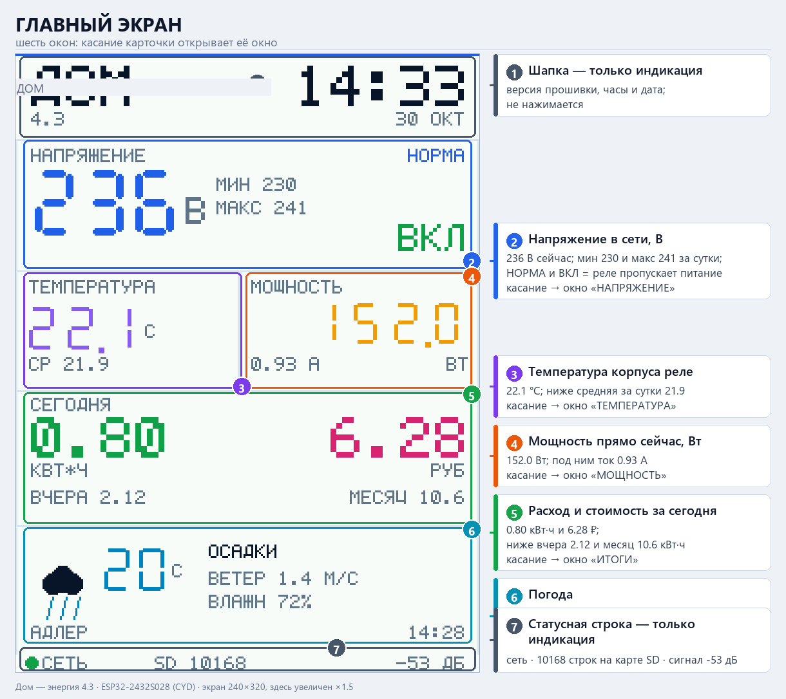

*На картинке: рамка и номер — нажимаемая зона, справа — что она показывает. Ниже тот же экран без подписей.*


**Что показывает.** Сверху — имя «ДОМ», версия 4.4, время и дата. Ниже пять
карточек:

| Карточка | Что на ней | Куда ведёт касание |
|---|---|---|
| НАПРЯЖЕНИЕ | 236 В, мин 230 / макс 241, «ВКЛ» | окно «НАПРЯЖЕНИЕ» |
| ТЕМПЕРАТУРА | 22.1 °C, средняя 21.9 | окно «ТЕМП РЕЛЕ» |
| МОЩНОСТЬ | 152.0 Вт, 0.93 А | окно «МОЩНОСТЬ» |
| СЕГОДНЯ | 0.80 кВт·ч, 6.28 ₽, вчера 2.12, месяц 10.6 | окно «ИТОГИ» |
| ПОГОДА | 20 °C, осадки, ветер 1.4 м/с, влажность 72% | окно «ПОГОДА» |

Внизу — статус: зелёная точка «СЕТЬ», число строк на карте (`SD 10168`) и
уровень сигнала (`-53 ДБ`). Если карты нет — «НЕТ SD», если Wi-Fi нет —
«НЕТ WI-FI».

**Сценарий.** Включаете плату → ждёте 10–30 секунд (Wi-Fi + NTP) → на
главном появляются значения. Дальше просто нажимаете карточку. Возврат —
верхняя полоса «‹ НАЗАД» в любом окне.

> На главном экране нет кнопки «настройки» и нет смены Wi-Fi. Сеть задаётся
> в `secrets.h` и прошивается вместе с кодом. Это осознанно: меньше экранов,
> которые можно случайно сломать.

### Напряжение — мин/сред/макс за сутки и график по часам

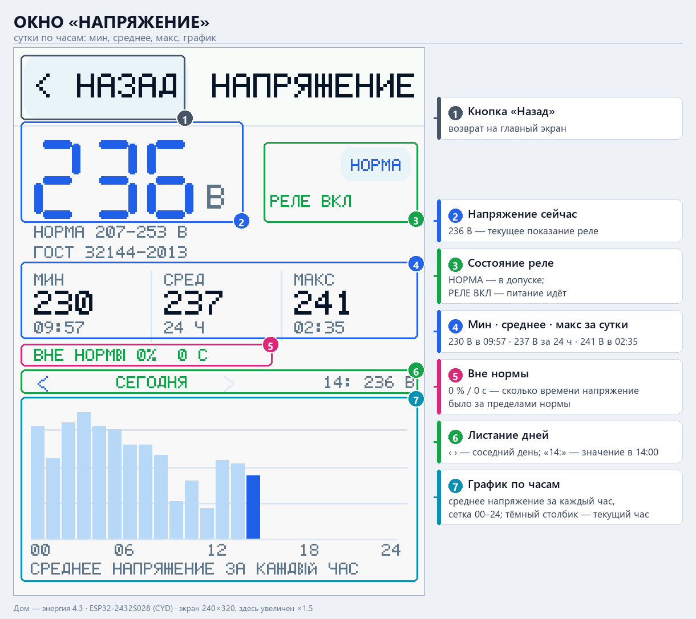

*Подписаны: назад, текущее значение, состояние реле, мин/сред/макс, «вне нормы», листание дней, график.*


**Что показывает.** Крупно — текущее напряжение (236 В) и вердикт «НОРМА».
Норма — 207–253 В по ГОСТ 32144-2013; ниже 190 или выше 265 — «АВАРИЯ».
Справа — «РЕЛЕ ВКЛ». Ниже три колонки: **МИН** 230 (09:57), **СРЕД** 237
(за 24 ч), **МАКС** 241 (02:35). Строка «ВНЕ НОРМЫ 0% 0 с» — сколько времени
напряжение было вне диапазона. Внизу — столбики среднего напряжения за
каждый час: 00…24, текущий час выделен синим.

**Сценарий.** Нажал карточку **НАПРЯЖЕНИЕ** → открылось окно → стрелками
**‹ ›** листаю дни. В центре строки графика — дата: «СЕГОДНЯ» или «29.10».
Нажатие на дату возвращает к сегодняшнему дню. Нажатие на столбик
показывает значение этого часа (повторное — снимает выделение).

**Листание дней.** Слева — более старый день, справа — более новый.
Ограничение — 60 дней назад и данные, которые реально есть на карте.

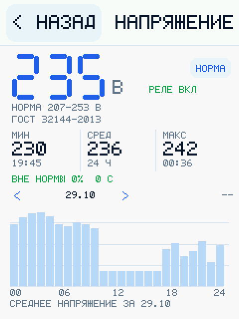

На скриншоте 29.10: мин 230 (19:45), сред 236, макс 242 (00:36), «ВНЕ НОРМЫ
0%». График заполнен до 24:00 — это полный день.

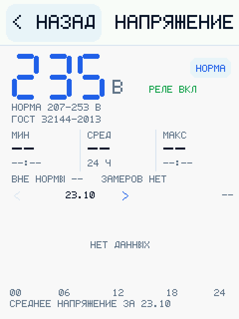

А здесь 23.10 — день, за который на карте нет строк. Плата честно пишет
**«НЕТ ДАННЫХ»**, а не рисует нули. Мин/сред/макс — `--`, «ЗАМЕРОВ НЕТ».
Это нормальное поведение: лучше пустота, чем ложный график.

### Температура реле — корпус, а не воздух

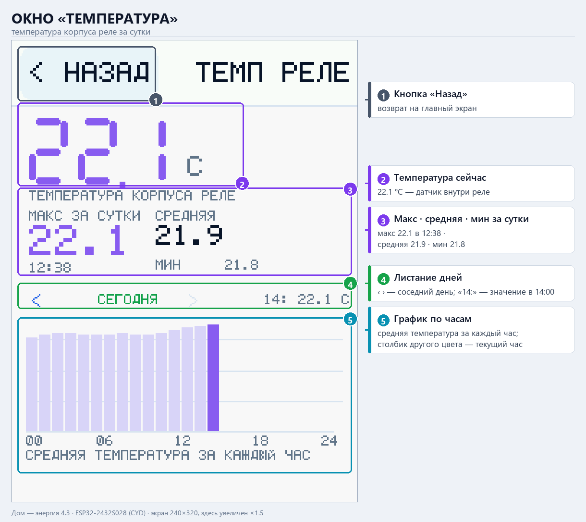

*Подписаны: назад, текущее значение, макс/сред/мин за сутки, листание дней, график.*

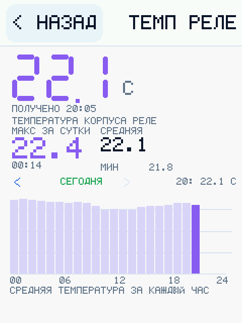

**Что показывает.** 22.1 °C — это температура **корпуса реле**, а не
комнаты. Подпись «ТЕМПЕРАТУРА КОРПУСА РЕЛЕ» стоит специально, чтобы не
путать с погодой. Ниже: максимум за сутки 22.1 (12:38), средняя 21.9,
минимум 21.8. Внизу — средняя температура по часам.

**Сценарий.** Главный → карточка **ТЕМПЕРАТУРА** → окно. Стрелки **‹ ›**
листают дни так же, как в напряжении. Нажатие на столбик — значение часа.

Почему это полезно: реле греется под нагрузкой, и по температуре корпуса
видно, не перегружен ли он. Но это **не** датчик воздуха в комнате.

### Мощность — мгновенная, средняя и пик

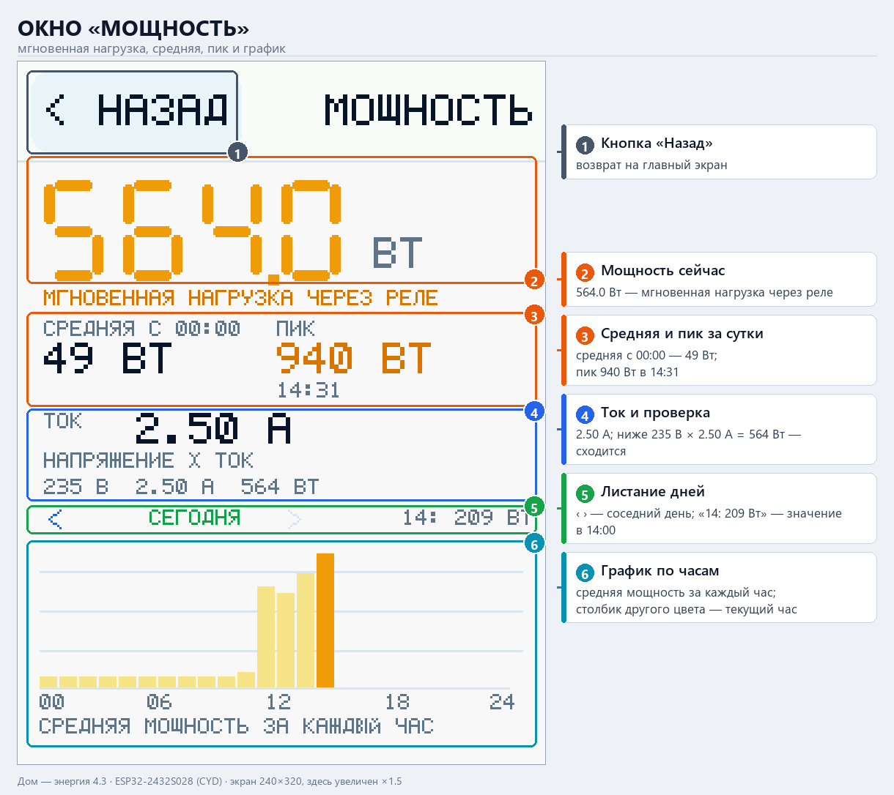

*Подписаны: назад, мгновенная мощность, средняя и пик, ток и проверка «напряжение × ток», листание, график.*

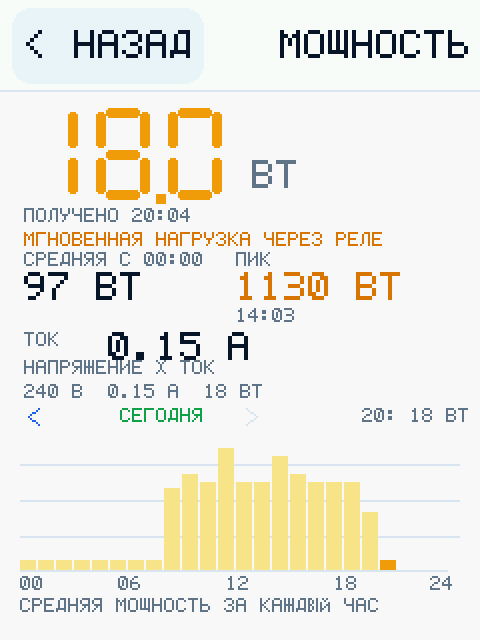

**Что показывает.** Крупно — мгновенная нагрузка **564.0 Вт** (в этот момент
что-то включили). Ниже: **СРЕДНЯЯ С 00:00** 49 Вт (текущий неполный час не
учитывается), **ПИК** 940 Вт в 14:31, **ТОК** 2.50 А. Строка «НАПРЯЖЕНИЕ ×
ТОК» — проверка: 235 В × 2.50 А ≈ 564 Вт. Внизу — средняя мощность по
часам; всплеск после 12:00 виден сразу.

**Время и длительность пика.** В окне МОЩНОСТЬ под пиком стоит строка
`ПИК 1117 ВТ / 16:53  3 МИН`: пик был в 16:53, и час держался не ниже
80 % от него 3 минуты. Длительность считается по гистограмме мощности
часа — по записям, которые идут раз в 30 секунд, поэтому короткий импульс
может округлиться до «1 МИН», даже если длился секунды.

**Сценарий.** Главный → **МОЩНОСТЬ** → окно. Стрелки **‹ ›** — дни,
нажатие на столбик — час. Если нажать на столбик, он выделяется, а подпись
показывает выбранный час.

Важно: «мгновенная» мощность приходит из облака Tuya (`phase_a`) и
обновляется не мгновенно, а раз в ~15–60 секунд. Без интернета локальный
DP 6 может отставать — это ограничение реле, а не экрана.

### Итоги — сегодня/вчера/месяц, тариф, прогноз

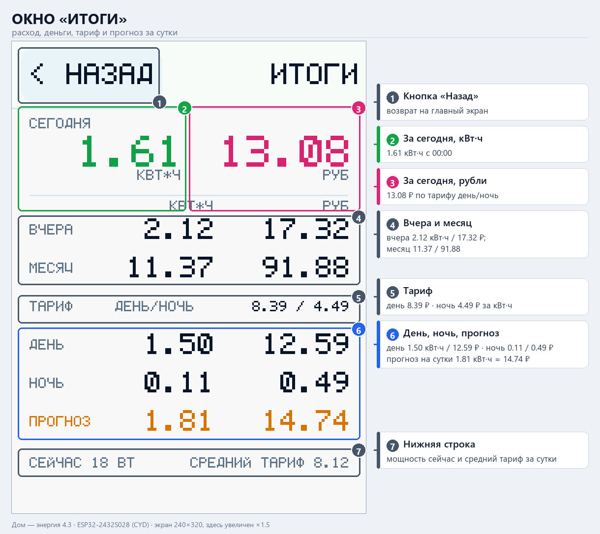

*Подписаны: назад, сегодня в кВт·ч и в рублях, вчера/месяц, тариф, день/ночь/прогноз, нижняя строка.*


> Скриншот окна ИТОГИ добавляется отдельно; ниже — описание по коду и
> реальному поведению.

**Что показывает.** Две крупные цифры: **СЕГОДНЯ** — кВт·ч и рубли. Под
ними строками:

| Строка | Что значит |
|---|---|
| ВЧЕРА | расход и стоимость за прошлые сутки |
| МЕСЯЦ | с начала месяца |
| ТАРИФ | день/ночь, например `8.39 / 4.49` |
| ДЕНЬ | расход и стоимость в дневной зоне 06–23 |
| НОЧЬ | расход и стоимость в ночной зоне 23–06 |
| ПРОГНОЗ | экстраполяция текущего темпа на месяц |
| СЕЙЧАС | мгновенная мощность |
| СРЕДНИЙ ТАРИФ | фактический средний тариф |

**Сценарий.** Главный → карточка **СЕГОДНЯ** → окно **ИТОГИ**. Здесь нет
стрелок: это сводка, а не история по дням. Чтобы посмотреть другой день —
вернуться назад и открыть напряжение/температуру/мощность, там стрелки.

Прогноз — это **оценка**, а не обещание: `сегодня × 24 / прошедшие часы`.
Если день только начался, прогноз будет грубым.

### Погода — откуда данные

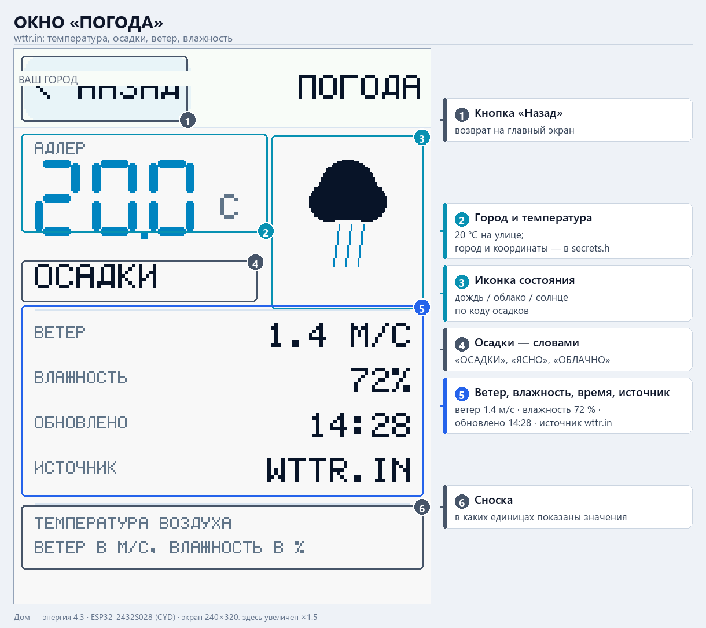

*Подписаны: назад, город и температура, иконка, осадки словами, ветер/влажность/время/источник, сноска.*

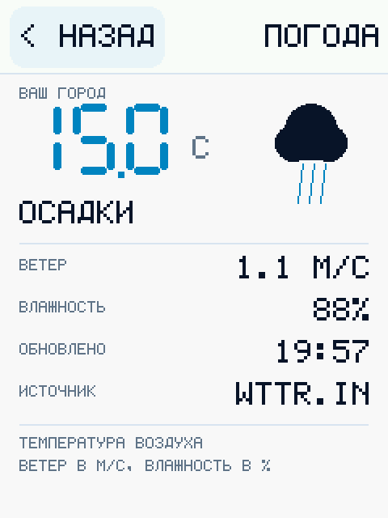

**Что показывает.** Город (подпись из `WEATHER_CITY`), температуру 20.0 °C,
описание «ОСАДКИ» с иконкой, ветер 1.4 м/с, влажность 72%, время обновления
14:28 и источник **WTTR.IN**. Внизу — пояснение: температура воздуха, ветер
в м/с, влажность в %.

**Сценарий.** Главный → **ПОГОДА** → окно. Обновление раз в 10 минут; если
интернета нет — «НЕТ ДАННЫХ» и «ПРОВЕРЬТЕ WI-FI», без зависания.

Данные берутся с `wttr.in` по координатам из `secrets.h`
(`WEATHER_LAT`/`WEATHER_LON`). По названию города wttr.in часто путает
точки, поэтому координаты надёжнее. В репозитории их нет.

### Калибровка тача — только по serial

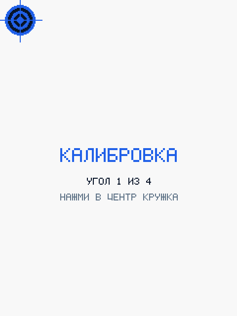

**Что показывает.** Экран калибровки: «КАЛИБРОВКА», «УГОЛ 1 ИЗ 4», «НАЖМИ В
ЦЕНТР КРУЖКА» и мишень в левом верхнем углу.

**Сценарий.** USB → монитор порта **115200** → команда `CALTOUCH` → нажать
четыре мишени по очереди (левый верх, правый верх, левый низ, правый низ).
После четвёртой — «ГОТОВО», значения в NVS. `CAL` — показать коэффициенты,
`CALRESET` — сбросить и перезагрузить.

С экрана калибровку запустить **нельзя**: экрана настроек нет. Это сделано
специально, чтобы случайное касание не сбило коэффициенты.

### Веб-страница — та же история, но удобнее

На компьютере:

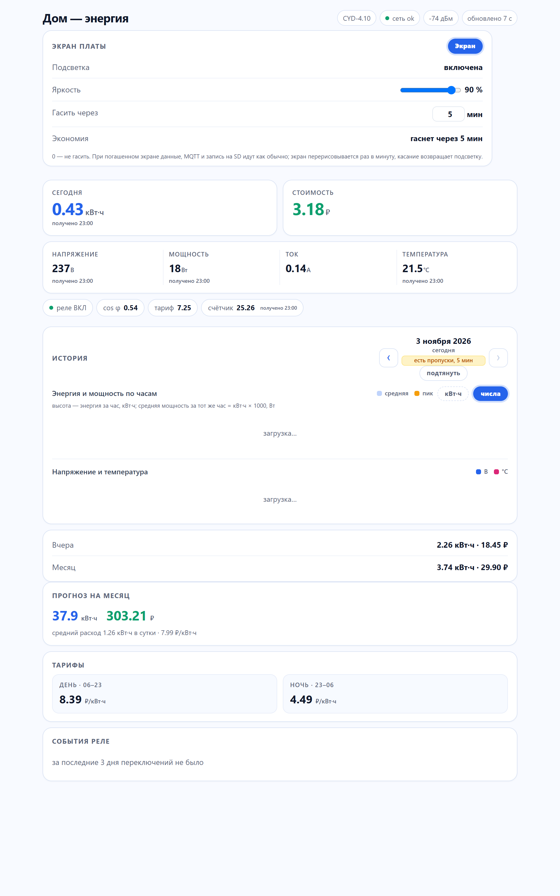

На телефоне:


**Что показывает.** Сверху — версия `CYD-4.4`, состояние сети, RSSI и
«обновлено N с». Две крупные карточки: «Сегодня» (кВт·ч) и «Стоимость» (₽).
Ниже — напряжение, мощность, ток, температура; пилюли «реле ВКЛ», `cos φ`,
тариф, счётчик. В блоке «История» — дата с стрелками **‹ ›**, графики:

- энергия по часам, кВт·ч;
- мощность по часам: средняя (столбики) и пик (тёмные штрихи);
- напряжение и температура: две линии с двумя осями.

Ещё ниже — «Вчера», «Месяц», «Прогноз на месяц», «Тарифы» и «События реле».

**Сценарий.** Открыли `http://<IP-платы>/` → страница сама обновляет
`/data` каждые 5 секунд. Нажали **‹** — ушли на 29 октября, **›** — вернулись.
Навели на столбик мощности — появилась подсказка:

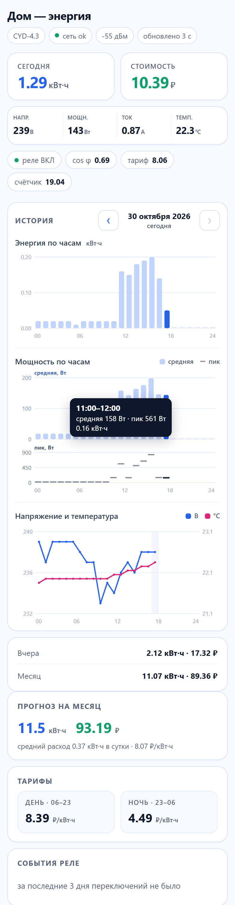

«11:00–12:00, средняя 158 Вт, пик 561 Вт в 11:47, длился 4 мин, 0.16 кВт·ч» —
видно и фон, и всплеск, и когда именно он был.

**Почему у мощности две шкалы.** Раньше средняя и пик рисовались на одной
шкале 0–1000 Вт: средняя 150 Вт выглядела почти нулём, а пик 900 Вт —
огромным. Теперь сверху шкала средней (0–200 Вт), снизу — пика (0–900 Вт):

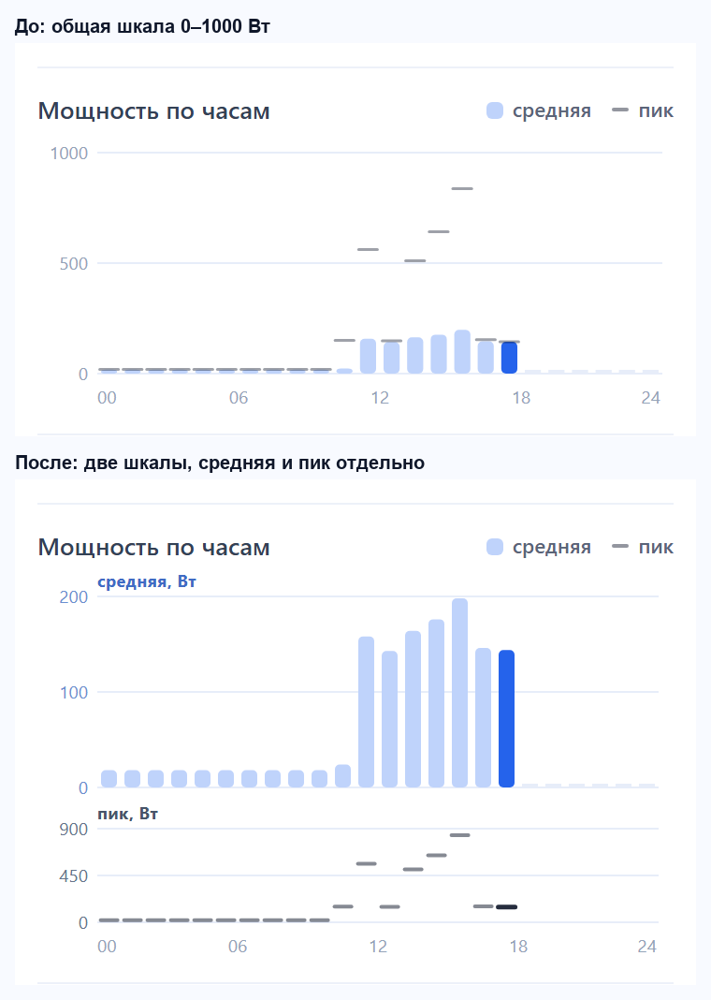

Сверху — «до» (общая шкала), снизу — «после» (две шкалы). Это не косметика:
раньше непонятно было, что именно происходит в обычные часы.

**Безопасность.** У страницы **нет пароля**. Она слушает порт 80 и доступна
всем в вашей локальной сети. Не пробрасывайте порт на роутере в интернет;
для удалённого доступа — только VPN.

---

## 🔆 Экран, светодиод и динамик

Настраивается по serial (подсветка — ещё и по HTTP), хранится в NVS.

### Подсветка экрана

GPIO 21, ШИМ 5 кГц / 8 бит — яркость плавная, а не «вкл/выкл».

```text
DISP            состояние: DISP: on=1 bright=255
DISP ON         включить (яркость 255)
DISP OFF        выключить: экран гаснет, тач продолжает работать
DISP 30         яркость 30 % → в ШИМ уходит 77 из 255
DISP TOGGLE     вкл/выкл — это шлёт кнопка «Экран платы» в приложении
DISP TOUCH      включить реакцию на касание
DISP NOTOUCH    отключить реакцию на касание
```

В NVS (namespace `disp`): `bright` — `0` выключено, `1–255` яркость; `touch` —
реакция на касание. Касание при погашенном экране включает подсветку на
20 секунд, повторное касание продлевает.

**Зачем.** Ночью подсветка 2.8" светит на всю комнату. С `DISP OFF` плата
работает дальше — пишет историю, читает реле, отдаёт страницу, — а состояние
видно по светодиоду. Проверено на плате: `DISP OFF` → `on:0, bright:0`;
`DISP ON` → 255; `DISP 30` → 77. `DISP TOGGLE` возвращает последнюю яркость,
но после перезагрузки «выкл» остаётся «выкл»: прошлая яркость в NVS не хранится.

| HTTP | Что делает |
|---|---|
| `GET /disp` | состояние: `{"ok":true,"on":1,"bright":255,"touch":1,"wake":0}` |
| `/disp?on=0` / `?on=1` | выключить / включить |
| `/disp?bright=30` | яркость в процентах, `0` — выключить |
| `/disp?touch=0` | отключить реакцию на касание |
| `/disp?wake=1` | «разбудить» на 20 секунд |

Поля в `/data`: `disp` (1/0), `bright` (0–255), `wake` (секунд до конца
пробуждения), `dtouch` (1/0 — будит ли касание).

### Светодиод — что означает цвет

| Цвет | Что значит | `/data led` |
|---|---|---:|
| Зелёный ровно | всё хорошо: сеть, реле, карта | 4 |
| Жёлтый ровно | нет интернета — локально, напряжение может быть устаревшим | 3 |
| Красный ровно | нет Wi-Fi или связи с реле (2 неудачи подряд) | 1 |
| Оранжевый мигает 1 Гц | нет SD-карты или 2 ошибки записи | 2 |
| Синий | загрузка (0–3 с), перед перезагрузкой | 0 |
| Зелёный тускло (20 %) | подсветка погашена | 5 |

Приоритет: **красный > оранжевый > жёлтый > зелёный**. Тусклый зелёный — «всё
хорошо», но экран погашен: ночью не слепит.

```text
LED            состояние: LED: green (net=1 relayFail=0 sd=1 sdw=0 dark=0)
LED TEST red   ... orange | yellow | green | dim | blue | off — на 15 секунд
LED RESET      вернуть автоматический режим
```

### Динамик — звуковые сигналы

**Подключение:** GPIO 26 → «+» динамика, GND → «−». Пьезоизлучатель или
динамик 8 Ом, громкость не выше 50 % ШИМ. **По умолчанию ВЫКЛЮЧЕН** — `BEEP ON`.

```text
BEEP                 состояние: BEEP: on=0 vol=50 touch=1 hour=0
BEEP ON / BEEP OFF   включить / выключить
BEEP TEST            проверить (пищит даже при выключенном)
BEEP VOL 0..100      громкость
BEEP TOUCH           пик при касании (переключатель)
BEEP HOUR            пик в начале часа (переключатель)
```

| Сигнал | Когда | Как звучит |
|---|---|---|
| касание | `BEEP ON` + `BEEP TOUCH` | 25 мс, 2.6 кГц |
| напряжение вне 207–253 В | дольше 10 с | 3 пика по 120 мс, не чаще 1 раза в 5 мин |
| температура реле | выше 55 °C | 600 мс раз в 5 мин |
| потеря SD | карта пропала | 2 пика |
| начало часа | `BEEP HOUR` | 1 пик |

Кроме `BEEP TEST`, всё звучит только при `BEEP ON`. Настройки — NVS `beep`
(`on`, `vol`, `touch`, `hour`), в `/data` — `beep` и `vol`.

---

## 🔌 Home Assistant, MQTT и автообнаружение

Плата умеет публиковать показания в MQTT-брокер и **сама сообщает Home Assistant, какие у неё датчики**. Ничего прописывать в `configuration.yaml` не надо: открыл HA — устройство уже там, со всеми сенсорами и в одной карточке.

### Что появляется в Home Assistant

| Датчик | Единица | Тип |
|---|---|---|
| Напряжение | V | sensor |
| Мощность | W | sensor |
| Ток | A | sensor |
| Температура реле | °C | sensor |
| Счётчик всего | kWh | sensor |
| Расход сегодня | kWh | sensor |
| Расход вчера | kWh | sensor |
| Расход за месяц | kWh | sensor |
| Стоимость сегодня | ₽ | sensor |
| Уровень Wi-Fi | dBm | sensor |
| Работает | s | sensor |
| Реле | — | binary_sensor |
| Сеть | — | binary_sensor |

Устройство в HA называется **«Дом — энергия»**, производитель NIKA SERVICE, модель `CYD-4.4 (ESP32-2432S028)`.

### Как включить — три шага

**1. Брокер.** В Home Assistant: `Настройки → Дополнения → Магазин → Mosquitto broker → Установить → Запустить`.

**2. Пользователь для MQTT.** `Настройки → Люди → Добавить пользователя` — например `mqtt` / свой пароль.

**3. Включить MQTT на плате.** Одной командой по HTTP — перепрошивка не нужна:

```text
http://192.168.1.51/mqtt?host=192.168.1.72&port=1883&user=mqtt&pass=ПАРОЛЬ
```

Настройки сохраняются в памяти платы и переживают перезагрузку. Выключить — `/mqtt?off=1`.

В Home Assistant останется добавить интеграцию: `Настройки → Устройства и службы → Добавить интеграцию → MQTT → Брокер` и указать адрес, порт и логин. После этого все 13 датчиков появятся сами.

### Дашборд

В комплекте — готовый дашборд **«Дом — энергия»**: показания сейчас, расход и стоимость, графики мощности, напряжения и температуры за 24 часа, столбики энергии за 7 дней.

### Команды

```text
relay_on     включить реле
relay_off    ЗАБЛОКИРОВАНО — отвечает off_blocked
refresh      обновить данные немедленно
```

**Выключение реле намеренно заблокировано.** Удалённо обесточить дом — слишком опасная операция для случайного нажатия. Включать — можно.

### Что публикуется в MQTT

Топики с префиксом `dom_energy`:

```text
dom_energy/state        все показания, JSON, раз в 30 с
dom_energy/status       online / offline (retained, LWT)
dom_energy/cmd          команды от Home Assistant
dom_energy/result       ответ на команду
homeassistant/sensor/dom_energy/<ключ>/config        описание датчика
homeassistant/binary_sensor/dom_energy/<ключ>/config
```

Всё — только в локальной сети. Наружу ничего не уходит.

### Диагностика

```text
GET /mqtt      состояние: включён, подключён, счётчики, последний топик
GET /data      поля mq, mqN, mqFail
MQTTSET "192.168.1.72" 1883 "mqtt" "пароль"     по serial
```

Если брокер недоступен — плата продолжает работать как обычно: экран, история, веб-страница. MQTT — дополнительный канал, а не замена.

### Требования к памяти

MQTT занимает около 3 КБ кучи: было 111 КБ свободно, стало 108 КБ. Сборка выросла с 39 % до 39 % (1 240 233 → 1 254 365 байт).

---

## 🎛 Все команды

Все команды — по serial-монитору. Порт **115200**, строка до Enter, регистр не важен. Строки
`{"t":"data",...}` плата печатает сама — раз в цикл опроса и один раз при
старте; отдельной команды `DATA` нет, состояние по запросу отдаёт `STATUS`.

| Команда | Что делает |
|---|---|
| `STATUS` | JSON: `fw` (`CYD-4.4`), uptime, Wi-Fi, RSSI, IP, реле, карта, heap |
| `IP` | IP-адрес, SSID, RSSI |
| `DIAG` | диагностика: напряжение, пропуски, карта, облако |
| `NET` | сеть: Wi-Fi, IP, интернет, принудительное отключение |
| `NETOFF` / `NETON` | принудительно без интернета / проверить заново |
| `WIFIOFF` / `WIFION` | выключить / включить Wi-Fi |
| `WIFISET "сеть" "пароль"` | сменить Wi-Fi; при неудаче — откат |
| `RAW` | показания тача и калибровка |
| `WD` | сторож камер (в интерфейсе отключён) |
| `CSV` | хвост `/energy.csv` |
| `CSVDAY` | строки за сегодня |
| `CSVT` | шесть последних строк за сегодня |
| `CSVH` | восстановленные из облака строки |
| `CSVHIST` | восстановление истории из облака |
| `CSVHEAD` | начало файла и первая строка месяца |
| `IMP` | импорт истории из облака в serial |
| `WCLR` | очистить кэш погоды |
| `PERIODRESET` | сбросить базы сегодня / вчера / месяц |
| `PWRFILL` | дозаполнить график мощности |
| `PWRHIST [диапазон]` | мощность прошлых дней по облаку |
| `GAPFILL [DRY]` | заполнить пропуски; `DRY` — только показать |
| `TAP x y` | эмуляция касания |
| `TAPTEST` | тач-тест с координатами |
| `CAL` | коэффициенты калибровки |
| `CALTOUCH` | калибровка по четырём углам |
| `CALRESET` | сброс калибровки и перезагрузка |
| `REBOOT` | перезагрузка |
| `DEMO` | демо-ИТОГИ: 123.45 кВт·ч / 1234.56 ₽ |
| `SHOT 0..6` | экран в serial — лента для `shot.py` |
| `DISP ...` | подсветка: `ON`, `OFF`, `TOGGLE`, `0..100`, `TOUCH`, `NOTOUCH` |
| `LED ...` | светодиод: `TEST <цвет>`, `RESET` |
| `BEEP ...` | динамик: `ON`, `OFF`, `TEST`, `VOL n`, `TOUCH`, `HOUR` |

---

## 🌐 Все HTTP-эндпоинты

Порт 80, без пароля — только доверенная LAN.

| Эндпоинт | Что делает и когда нужен |
|---|---|
| `/` | веб-страница с графиками и листанием дней |
| `/data` | текущие значения JSON — для страницы, приложения, скриптов |
| `/days` | дни с данными — до какого числа есть история |
| `/history?date=YYYY-MM-DD` | почасовая история за день — графики и отчёты; у каждого часа `pmaxT` (время пика) и `pmaxDur` (длительность, секунды) |
| `/events` | переключения реле — когда включалось и выключалось |
| `/day` | строки по часам за сегодня, текстом — проверить запись |
| `/csv` | хвост `/energy.csv` (~3.5 КБ) — взглянуть глазами |
| `/full?file=&from=&len=` | чтение файла со смещения — выкачать историю без карты |
| `/files` | файлы на карте с размерами — ротация и место |
| `/rotate` | ротация по месяцам (`?force=1`) — освободить файл |
| `/tap?x=&y=` | эмуляция касания — проверка экранов без COM |
| `/disp` | подсветка: `on`, `bright`, `touch`, `wake` — погасить на ночь |
| `/gapfill` | пропуски: состояние, `?run=1` заполнить, `?undo=1` откатить |
| `/gapfill/status` | фаза и вставленные строки — когда `?run=1` идёт долго |
| `/pwrhist` | дозаполнение мощности (`?range=...`) — исправить колонку |
| `/pwrhist/status` | состояние и этап дозаполнения |
| `/wifiset?ssid=&pass=` | сменить Wi-Fi без USB — когда COM занят |
| `/netdiag` | DNS, TCP 443, TLS, тайминги — где именно нет интернета |
| `/clog` | кольцо запросов к облаку — почему нет напряжения |
| `/cloudtest` | один запрос в облако — проверить ключи |
| `/pagefree` | оставлено для совместимости: кэша страницы больше нет, память не занимается |
| `/restorebak` | откат `/energy.csv` из `/energy.bak` — файл побился |

### Что отдаёт `/history` за каждый час

Раньше время пика было только у часов, дозаполненных из облака. Теперь — у
**каждого часа с данными**:

```json
{"h":16,"kwh":0.25,"p":255,"pmax":1117,"pmaxT":"16:53","pmaxDur":180,"v":238,"t":21.8,"n":112}
```

| Поле | Что значит |
|---|---|
| `h`, `kwh` | час и энергия за него, кВт·ч |
| `p`, `pmax` | средняя и пиковая мощность, Вт |
| `pmaxT` | время пика, `ЧЧ:ММ`; у старых часов без минуты — `null` |
| `pmaxDur` | сколько **секунд** час был не ниже 80 % от пика |
| `v`, `t`, `n` | напряжение, температура, число записей в часе |

`pmaxDur` — секунды, а не минуты: так точнее и удобнее приложению. На экране
и странице они показываются минутами.

---

## 🔧 Установка

В программе для Windows есть **мастер настройки**, который проводит по шагам и **сам всё настраивает** —
консоль не нужна.

| Шаг | Что делает |
|---|---|
| **1. Поиск** | перебирает COM-порты, на каждом `esptool flash_id`, отличает нашу плату (CH340, VID `1A86`) от ESP32-C3 (VID `303A`) |
| **2. Прошивка** | читает версию платы через `STATUS`, сверяет с версией в установщике; можно оставить как есть или перепрошить |
| **3. Wi-Fi** | берёт имя и пароль текущей сети Windows; **если компьютер по кабелю** — просит ввести имя сети вручную и подсказывает про 2.4 ГГц |
| **4. Сеть** | читает IP из serial, проверяет `http://IP/data` и `cyd.local`, сохраняет адрес |
| **5. Готово** | приложение переключается на работу по сети, USB больше не нужен |

**Что передаётся плате:** команда `WIFISET "сеть" "пароль"` по serial. Плата пишет
сеть в свою память и подключается. **Если пароль неверный — сама возвращается
на прежнюю сеть** через 20 секунд, связь не теряется.

```text
IP          →  IP: 192.168.1.51 ssid=YOUR_WIFI_NAME rssi=-49
WIFISET     →  WIFISET: ERR нужен SSID, пример: WIFISET "сеть" "пароль"
WIFISET "x" "y"  →  WIFISET: подключаюсь... → OK или ERR timeout + откат
```

После настройки плата доступна как **`cyd.local`** — не зависит от смены IP.

---

## 💻 Программа для Windows

`pc/DomMonitor.ps1` — **отдельная программа для компьютера**: PowerShell + WinForms,
ничего устанавливать не надо, интернет ей самой не нужен (она ходит в локальную
сеть к плате). Запуск — двойной щелчок по файлу. Рядом лежит `pc/DomMonitor-run.ps1` —
супервизор: запускает программу и перезапускает её при падении, лог пишет в
`%APPDATA%\DomMonitor\supervisor.log`.

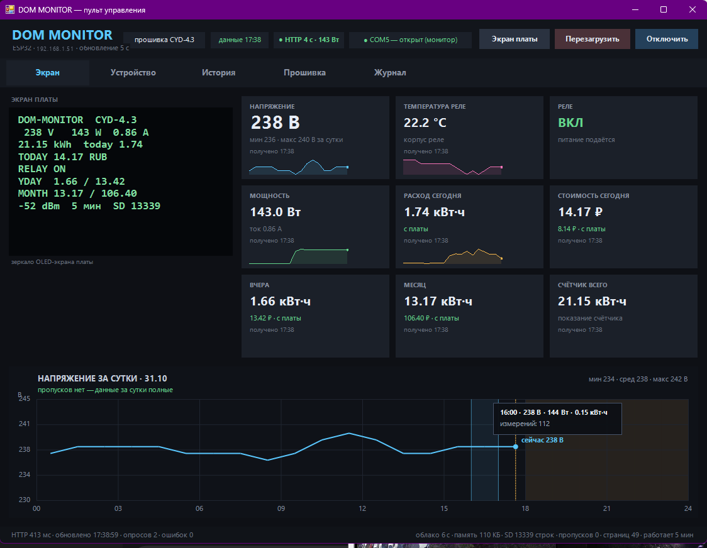

**Зачем она нужна.** На экране платы 480×320: цифры видно, а график только в
миниатюре. В программе те же данные, но крупно — график за сутки с осью 00–24 ч,
история по дням, таблица 24 часов, журнал. Показывает то же, что плата, но
удобнее: большие графики, история по дням, журнал. Плата при этом продолжает
работать сама — программа это пульт, а не обязательная часть системы.

### Вкладки

| Вкладка | Что показывает |
|---|---|
| **Экран** | зеркало экрана платы (тот же текст, что на экране платы) + 9 карточек с показателями + график напряжения за сутки с осью 00–24 ч, мин/сред/макс, янтарные полосы пропусков |
| **Устройство** | свойства платы (источник данных, COM-порт, адрес, прошивка, память, карта, тариф), смена порта и адреса, кнопка «Мастер настройки» |
| **История** | выбор дня ‹ ›, таблица 24 часов + ИТОГО, график мощности/напряжения/температуры, пропуски, «Отчёт в Telegram», «CSV дня» |
| **Прошивка** | сборка и заливка прошивки (папка со скетчем + `huge_app`) |
| **Журнал** | подробный лог: источник данных, время ответа, состояние облака и карты, ошибки |

### Кнопки

| Кнопка | Что делает | Когда нужна |
|---|---|---|
| **Экран платы** | включает/выключает подсветку экрана платы (команда `disp` по serial) | на ночь, чтобы не светило; при выключении остаётся светодиод |
| **Перезагрузить** | перезагружает плату (команда `reboot` по serial, с подтверждением) | если плата зависла или после смены настроек |
| **Отключить / Подключить** | открывает/закрывает COM-порт | COM нужен только для команд «Экран платы» и «Перезагрузить»; данные идут по Wi-Fi |
| **‹ ›** (История) | предыдущий / следующий день | посмотреть прошлые сутки |
| **Сегодня** (История) | вернуться к текущей дате | после просмотра архива |
| **Обновить** (История) | перезапросить историю выбранного дня | если день открыт давно |
| **Отчёт в Telegram** (История) | отправляет отчёт за выбранный день | когда нужна сводка за день |
| **CSV дня** (История) | сохраняет историю дня в файл | для Excel или архива |
| **Применить** (Устройство) | запоминает выбранный COM-порт | сменили USB-адаптер |
| **Список** (Устройство) | перечитывает список COM-портов системы | плату только что подключили |
| **Сменить адрес** (Устройство) | меняет IP-адрес платы, по которому идут данные | переехали в другую сеть |
| **Мастер настройки** (Устройство) | пошаговая настройка: поиск платы, прошивка, Wi-Fi | при первом запуске или смене Wi-Fi |
| **ПРОШИТЬ** (Прошивка) | собирает и заливает прошивку | обновление версии |
| **Только собрать** (Прошивка) | компилирует без заливки | проверить, что скетч собирается |
| **…** (Прошивка) | выбрать папку скетча | другой проект |
| **Очистить** (Журнал) | чистит окно лога (файл не трогает) | стало шумно |

### Показатели: что это и как посчитано

У карточек с мини-графиком (напряжение, мощность, температура, расход) есть
подсказка при наведении, а щелчок открывает «Историю» с этим показателем.
Подробно про каждый:

| Показатель | Что это | Как считается | Зачем |
|---|---|---|---|
| **Напряжение** | напряжение в сети, В | от реле Tuya: локальный протокол (DP 6) или облако (`phase_a`); плата отдаёт его в `/data` как `v` | следить за качеством сети: норма 207–253 В по ГОСТ 32144-2013; при выходе — риск для техники |
| **Температура реле** | температура **корпуса** реле, °C | от реле (`temp_current`), это не воздух в комнате | перегрев реле = риск пожара; норма до 55 °C |
| **Реле** | включено реле или нет | состояние из `/data` (`r`) | понять, почему нет мощности при живом напряжении |
| **Мощность** | текущая нагрузка, Вт | поле `p` от реле (`phase_a`: напряжение × ток) | видеть, что включено и сколько потребляет |
| **Ток** | сила тока, А | из `phase_a` реле; вторая строка карточки «Мощность» | проверка: мощность = напряжение × ток |
| **Расход сегодня, кВт·ч** | сколько накрутило с 00:00 | разница счётчика энергии от начала суток (`tkwh`) | контроль дневного расхода |
| **Стоимость сегодня, ₽** | сколько это стоит | расход × тариф, считает плата (`tcost`) | понимать, во что обходится |
| **Вчера** | расход и стоимость за прошлые сутки | из истории платы (`ykwh`, `ykost`) | сравнение с сегодня |
| **Месяц** | с начала месяца | база счётчика на 1-е число + расход (`mkwh`) | контроль месячного счёта |
| **Счётчик всего, кВт·ч** | показание счётчика реле | напрямую от реле (`e`) | сверка с квитанцией |
| **Средняя мощность за час** | средняя за час, Вт | сумма всех записей часа / их количество (`p` в `/history?date=`) | видеть профиль дня |
| **Пик мощности за час** | максимальная мощность в часе, Вт | максимум из записей часа каждые 30 с (`pmax`) | ловить короткие включения (чайник, инструмент) |
| **Время пика** | когда случился пик, ЧЧ:ММ | момент максимальной записи часа (`pmaxT`) | связать всплеск с событием: чайник, насос, сварка |
| **Длительность пика** | сколько час был ≥80 % от пика, минуты | гистограмма мощности часа, сумма секунд в корзинах ≥80 % (`pmaxDur` — секунды) | отличить короткий импульс от долгой нагрузки |
| **«получено 12:31»** | когда последний раз приходили данные | отметка времени получения последнего значения, у каждой карточки своя | понять, какой источник отвалился: облако (напряжение) или реле (температура, счётчик) |
| **Тариф** | текущая цена кВт·ч | 8.39 ₽ день (06–23), 4.49 ₽ ночь (23–06); приходит от платы (`tariff`), виден в подписи «Стоимость сегодня» | считать стоимость правильно |
| **Пропуски** | часы без данных | плата считает по журналу (`gaps`, `gapMin`); в «Истории» — «пропусков нет» или «часов без записей N» | честно видеть, где данных нет |
| **cos φ** | коэффициент мощности | приходит от реле; показывается на веб-странице платы, в окне программы не выводится | 1.0 — активная нагрузка, ниже — реактивная (насос, компрессор, импульсный блок питания) |

### История за день

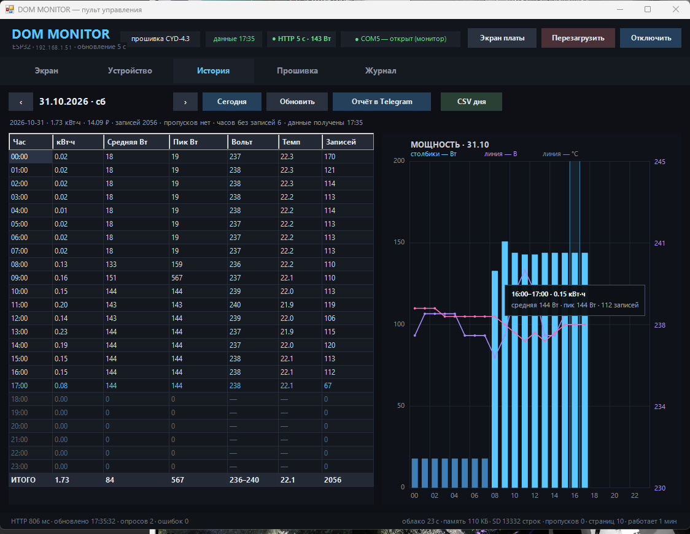

Слева — таблица 24 часов: кВт·ч, средняя и пик мощности, вольты, температура,
число записей; внизу ИТОГО. Справа — график, показатель выбирается щелчком по
карточке на вкладке «Экран». Наведение на столбик показывает всё сразу:
«16:00–17:00 · 0.15 кВт·ч · средняя 144 Вт · пик 144 Вт · 112 записей».

Неполный час виден честно:


«17:00–18:00 (час не закончился) · 68 записей» вместо обычных ~112: столбик ниже
не потому, что расход упал, а потому что день ещё идёт. В подписи дня при этом
считаются пропуски: «пропусков нет · часов без записей 6» — это вечерние часы,
которых пока нет.

### Журнал

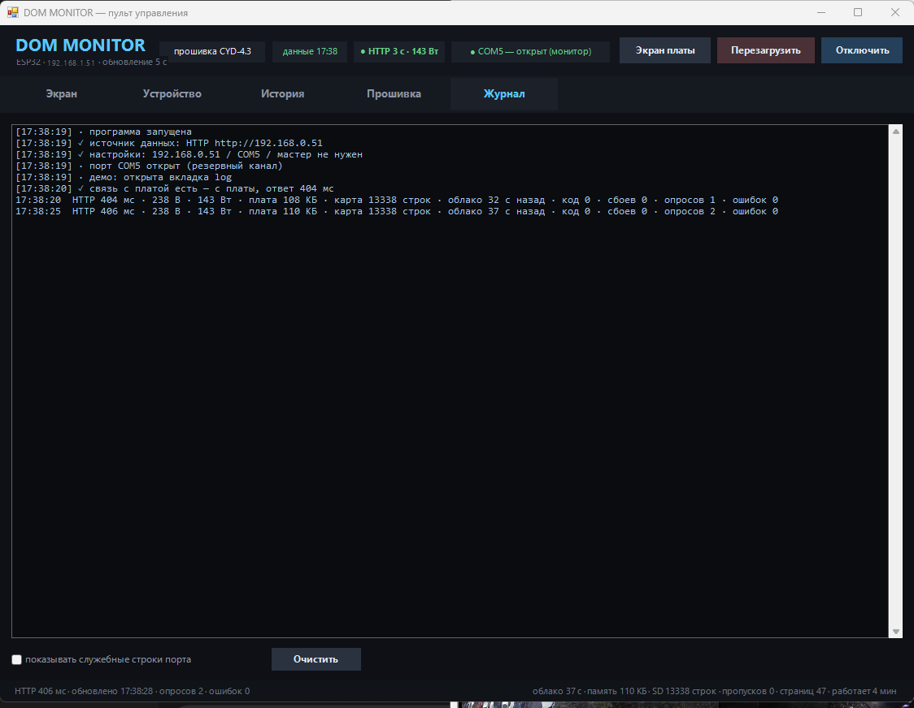

Источник данных (`HTTP` или `serial`), время ответа, память платы, строки на
карте, сколько данных в облаке и когда оно отвечало в последний раз, ошибки
опроса. Чекбокс «показывать служебные строки порта» добавляет сырой обмен по COM.

### COM-порт: три состояния

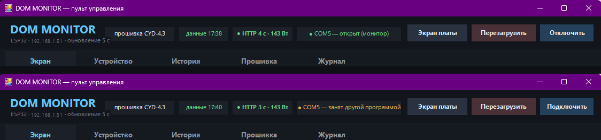

Сверху — порт открыт этой программой («открыт (монитор)», кнопка «Отключить»),
снизу — порт занят другой программой («занят другой программой», кнопка
«Подключить»). Третье состояние — «закрыт (свободен)». Данные идут по Wi-Fi,
поэтому порт нужен только для команд.

### Мастер настройки

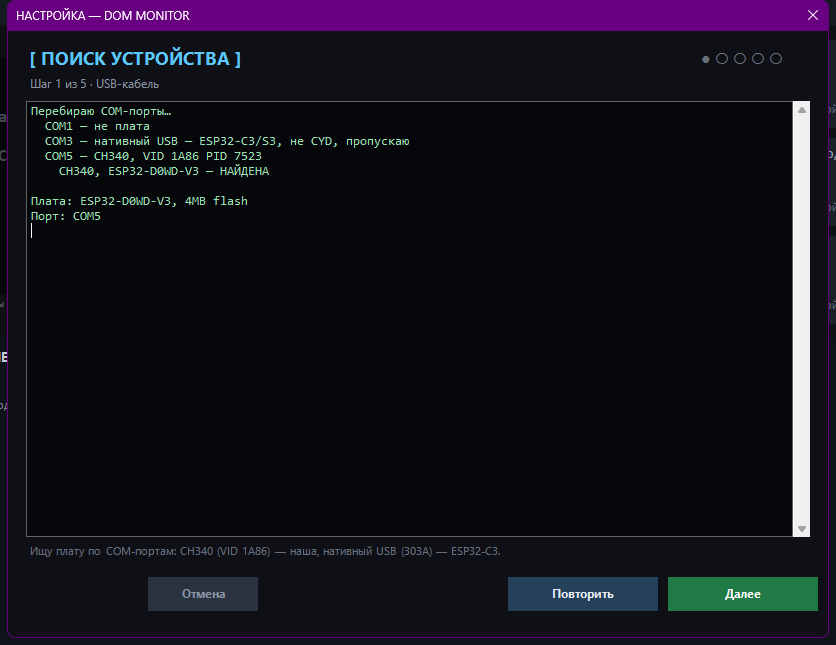

Шаг 1 из 5: перебирает COM-порты и отличает нашу плату (CH340, VID `1A86`) от
ESP32-C3 (VID `303A`). Дальше — прошивка, Wi-Fi, проверка адреса; подробно в
разделе [«Установка»](#-установка).

### Как это работает

- приложение опрашивает плату по HTTP `http://192.168.1.51/data` раз в 5 секунд;
- историю берёт из `/history?date=YYYY-MM-DD`, список дней — из `/days`;
- адрес платы и COM-порт хранятся в `%APPDATA%\DomMonitor\settings.json`, меняются на вкладке «Устройство»;
- serial (COM5) — только резерв и команды `disp`/`reboot`; если порт занят, программа продолжает работать по HTTP;
- если плата недоступна — «НЕТ СВЯЗИ», карточки с прочерком, программа не падает и сама восстанавливается, когда плата вернётся;
- в подвале окна видно, сколько было опросов, сколько ошибок и когда данные обновились последний раз.

---

## ☁ Восстановление истории из облака

Две команды закрывают пропуски в истории. Обе работают на самой плате.

### `GAPFILL` — пропуски

Плата перезагружалась, теряла Wi-Fi, была выключена — в истории дырки. **GAPFILL
сам находит их и дописывает из облака.**

```text
GAPFILL                последние 2 суток
GAPFILL 7              последние 7 дней (предел облака)
GAPFILL LIST           только показать, ничего не писать
```

- заполняет пропуски **больше 2 минут**, свежие (моложе 5 минут) не трогает
- вставляет строки каждые ~16 секунд с меткой `cost=0.00`
- реле: мощность 0 → реле 0, иначе 1
- **запускается автоматически через минуту после старта**

### `PWRHIST` — мощность

До версии 4.3 колонка мощности бралась из локального датчика и могла содержать
устаревшие значения (19 Вт при работающем приборе). `PWRHIST` перезаписывает её
почасовыми средними из облака. **Колонка энергии не трогается** — она из счётчика и всегда верна.

```text
PWRHIST                       последние 7 дней
PWRHIST 2026-10-23 2026-10-29
PWRHIST 23 29
```

### Что это дало на практике

| Что было неверно | Стало |
|---|---|
| Макс. напряжение за 30.10: **241 В** | **242 В** — нашёлся скачок в пропущенных данных |
| Пик мощности 29.10 в 18:00: **72 Вт** | **145 Вт** — пропущенная нагрузка |
| Час 11 за 29.10: **20 Вт / 146 Вт** | **322 Вт / 1833 Вт** |
| Строк в часе 18: 98 | 111 |

**Энергия при этом не меняется:** 29.10 осталось 2.12 кВт·ч. Изменяются только
мин/макс напряжения, пики мощности и температура.

Обе команды пишут файл безопасно: `.bak → .tmp → проверки → .old → замена`.
При любом сбое `/energy.csv` остаётся нетронутым. Откат — `/gapfill?undo=1`.

---

## 🔒 Какие данные публикуются, а какие нет

Коротко: **код и описание — да; ключи, пароли, адреса и история — нет.**
Полная версия — [docs/DATA-POLICY.md](docs/DATA-POLICY.md).

### Публикуется

| Что | Где |
|---|---|
| Исходный код прошивки | `firmware/cydv4/cydv4.ino` |
| Шрифт и веб-страница | `firmware/cydv4/font5x7.h`, `web/page.html` |
| Настройка TFT | `firmware/hw/User_Setup.h` |
| Схема данных, формат CSV | этот README, `docs/` |
| Скриншоты интерфейса | `docs/screenshots/` |
| Скрипты ПК | `pc/` |

### НЕ публикуется

- пароль и имя Wi-Fi;
- Tuya Device ID, Local Key, Client ID, Client Secret;
- IP-адреса реле, платы, компьютера;
- координаты города;
- история потребления (`energy.csv`, бэкапы);
- полный дамп flash/NVS;
- сборки `.bin/.elf/.map`.

Всё личное вынесено в `firmware/cydv4/secrets.h`, которого в репозитории
нет. Шаблон — [`secrets.example.h`](firmware/cydv4/secrets.example.h).
`secrets.h` уже в `.gitignore`.

### Что уходит в облако Tuya

Плата обращается к `openapi.tuyaeu.com` (HTTPS), только если есть интернет:

- `client_id`, подпись HMAC-SHA256, время, токен;
- Device ID в пути запроса;
- получает `total_forward_energy`, `phase_a`, `temp_current`, `switch`;
- для дозаполнения истории — почасовые записи за пропущенные часы.

Облако видит историю потребления устройства — это его штатная функция.
Пароль Wi-Fi и Local Key в облако **не уходят**.

### Что остаётся локально

- история на microSD;
- веб-страница (только LAN);
- serial/USB;
- бэкапы на вашем диске/NAS;
- ключи в `secrets.h` и NVS.

### Что уходит в wttr.in

Один HTTP GET с координатами:

```
http://wttr.in/~<широта>,<долгота>?format=%t|%h|%w|%C
```

Ни ключей, ни истории, ни Device ID. Если погода не нужна, не заполняйте
`WEATHER_LAT/LON` — экран покажет «НЕТ ДАННЫХ».

### Формат строки на SD

```csv
datetime,voltage,power,energy_kwh,relay,cost,temp
2026-10-30 14:33:07,236,152.0,19.04,1,10.39,22.1
```

| Поле | Что | Единица |
|---|---|---|
| `datetime` | локальное время платы | `YYYY-MM-DD HH:MM:SS` |
| `voltage` | напряжение | В |
| `power` | мощность на момент записи | Вт |
| `energy_kwh` | накопленный счётчик реле | кВт·ч |
| `relay` | реле | `1` / `0` |
| `cost` | накопленная стоимость с начала месяца | ₽ |
| `temp` | температура корпуса реле | °C |

Пишется не чаще раза в 30 секунд; без напряжения/времени/счётчика строка
не пишется. В конце месяца файл уходит в `/energy-YYYY-MM.csv`.

### Как получить ключи Tuya

Подробная инструкция со скриншотами шагов — [docs/TUYA-KEYS.md](docs/TUYA-KEYS.md):
регистрация на iot.tuya.com, Cloud-проект, привязка приложения по QR,
и главное — команда API, которая отдаёт `local_key`.

### Как настроить свои ключи

```powershell
cd firmware\cydv4
copy secrets.example.h secrets.h
notepad secrets.h
```

```cpp
#define WIFI_SSID      "ваша_сеть"
#define WIFI_PASS      "ваш_пароль"
#define TUYA_DEVICE_ID "..."
#define TUYA_LOCAL_KEY "..."
#define TUYA_CLIENT_ID "..."
#define TUYA_SECRET    "..."
#define RELAY_IP       "192.168.1.25"
#define PC_API_URL     "http://192.168.1.20:8090"
#define WEATHER_LAT    "YOUR_LAT"
#define WEATHER_LON    "YOUR_LON"
#define WEATHER_CITY   "ВАШ ГОРОД"
```

Проверка перед публикацией:

```powershell
git status --short
git grep -n "WIFI_PASS\|TUYA_SECRET\|LOCAL_KEY" -- . ":(exclude)firmware/cydv4/secrets.example.h"
```

Если в выводе реальные значения — не коммитьте.

---

## 🚀 Быстрый старт

### 1. Клонировать

```powershell
git clone https://YOUR-GIT-SERVER:3000/admin/dom-energy.git
cd dom-energy
```

### 2. Создать `secrets.h`

```powershell
cd firmware\cydv4
copy secrets.example.h secrets.h
notepad secrets.h
```

Заполните Wi-Fi (2,4 ГГц), ключи Tuya, IP реле. Если PC-сервера нет —
`PC_API_URL ""` (это необязательный сервер на ПК, его код в репозиторий не
входит). Координаты погоды можно оставить пустыми.

### 3. Поставить инструменты и настроить экран

```powershell
arduino-cli core install esp32:esp32@2.0.9
arduino-cli lib install TFT_eSPI@2.5.43

copy firmware\hw\User_Setup.h `
  "$env:USERPROFILE\Documents\Arduino\libraries\TFT_eSPI\User_Setup.h" -Force

cd firmware\cydv4
python web\build_page.py
cd ..\..
```

`User_Setup.h` обязателен: он лежит **вне скетча**, в библиотеке. Без него
экран будет чёрным.

### 4. Собрать и прошить

```powershell
$cli = "C:\Program Files\Arduino CLI\arduino-cli.exe"

& $cli compile `
  --fqbn "esp32:esp32:esp32:PartitionScheme=huge_app" `
  --libraries "$env:USERPROFILE\Documents\Arduino\libraries" `
  --build-path "build" `
  "firmware\cydv4"

& $cli upload `
  -p COM5 `
  --fqbn "esp32:esp32:esp32:PartitionScheme=huge_app" `
  --upload-property "upload.speed=921600" `
  --input-dir "build" `
  "firmware\cydv4"
```

Подробно, с ошибками и проверками — [BUILD.md](BUILD.md).
Восстановление после поломки — [RESTORE.md](RESTORE.md).

---

## 📁 Структура репозитория

```
dom-energy/
├── README.md                     этот файл
├── LICENSE                       MIT, 2026
├── BUILD.md                      сборка и прошивка CYD
├── RESTORE.md                    восстановление устройства
├── .gitignore                    секреты, сборка, данные
├── docs/
│   ├── README.md                 индекс документации
│   ├── АРХИТЕКТУРА.md            как устроено внутри
│   ├── ГРАБЛИ-И-РЕШЕНИЯ.md       краткая выжимка
│   ├── PITFALLS.md               полный разбор грабель
│   ├── WIRING.md                 пины и схема
│   ├── DATA-POLICY.md            политика данных
│   ├── TUYA-KEYS.md              ключи Tuya: где взять и как вписать
│   ├── RESTORE.md                краткая инструкция восстановления
│   └── screenshots/
│       ├── README.md             соответствие файлов
│       ├── board/                экраны платы
│       ├── web/                  веб-страница
│       └── pc/                   программа для Windows
├── firmware/
│   ├── cydv4/
│   │   ├── cydv4.ino             прошивка (без секретов)
│   │   ├── font5x7.h             шрифт
│   │   ├── secrets.example.h     шаблон ключей
│   │   └── web/
│   │       ├── page.html         исходник страницы
│   │       └── build_page.py     вставка страницы в .ino
│   └── hw/
│       └── User_Setup.h          настройка TFT_eSPI
├── pc/
│   ├── DomMonitor.ps1            GUI для Windows: экран, история, прошивка
│   ├── DomMonitor-run.ps1        супервизор: перезапуск при падении
│   ├── restore-board.ps1         восстановление платы
│   ├── backup-sd.py              бэкап истории по Wi-Fi
│   └── backup-firmware.py        архив исходников
└── tests/
    ├── test-board.py             сквозные тесты
    └── README.md                 как запускать
```

---

## ✅ Тесты

`tests/test-board.py` проверяет живую плату по HTTP: доступность,
физические границы, целостность CSV, сходимость мощности со счётчиком,
математику «сегодня/вчера», стоимость, прогноз и стабильность.

```powershell
$env:BOARD_URL = "http://192.168.1.50"   # ваш IP платы
python tests\test-board.py
```

Быстро:

```powershell
python tests\test-board.py --quick
```

Что именно проверяется и как читать вывод — [tests/README.md](tests/README.md).

---

## ⚠ Ограничения

- **Wi-Fi только 2,4 ГГц**, мощность передатчика 11 dBm.
- **Нет экрана настроек** и смены Wi-Fi с экрана: сеть задаётся либо в `secrets.h`,
  либо командой `WIFISET` по serial (её отправляет мастер настройки).
- **Нет OTA**: прошивка только по USB.
- **Нет отдельного DP мощности**; локальный DP 6 может отставать, облако
  свежее, но требует интернета.
- **У веб-страницы нет пароля** — только доверенная LAN.
- **Калибровка тача — только serial** (`CALTOUCH`).
- История не пишется без времени и без напряжения — это защита, а не баг.
- Экран «СТОРОЖ» в коде есть, но отключён (`wdTick()` не вызывается,
  `WD_UI 0`). В интерфейсе его нет.
- **Облако Tuya хранит историю 7 суток.** Пропуски старше недели `GAPFILL` не заполнит —
  только покажет пометкой.
- **`WIFISET` подключается до 20 секунд**; если сеть не отвечает — откат ещё 15 секунд.
  Сделано неблокирующим, интерфейс при этом работает.
- **Пик часа и его длительность считаются по записям** (раз в 30 секунд).
  Если нагрузка короткая и попала между записями, пик может быть занижен,
  а длительность — округлена.

---

## 👤 Разработчик

**Александр Смелков** (Alexander Smelkov)

| | |
|---|---|
| Компания | NIKA SERVICE |
| Сайт | [nika-sc.ru](https://nika-sc.ru) |
| Город | Сочи, Россия |
| GitHub | [@nika-sc](https://github.com/nika-sc) |
| Профиль | Программирование для медицинских приложений и сервисов |

Проект вырос из практической задачи: нужно было видеть, **когда** и **сколько**
потребляет дом, а не только итоговую сумму в квитанции. Всё, что здесь есть —
сделано и проверено на живом устройстве: 30 суток непрерывной работы,
12 000 строк истории, десятки найденных и исправленных ошибок.

Отдельная благодарность за терпение и подробные отчёты об ошибках —
без них половина этих исправлений не появилась бы.

### Связанные проекты

- [Nika Service CRM](https://github.com/nika-sc/Nika_Service_CRM) — CRM для сервисного центра

---

## 🤝 Как помочь проекту

Проект открыт, и любая помощь полезна:

| Что | Как |
|---|---|
| Нашли ошибку | Issue в трекере репозитория — с логами и версией прошивки |
| Есть идея | Issue с меткой `idea` или обсуждение в трекере |
| Сделали улучшение | Pull request — с описанием, что и зачем |
| Собрали такой же | Поделитесь фотографией и отзывом в issue |

**Что особенно пригодится:**
- проверка на других моделях реле Tuya (не только `Breaker`, категория `dlq`)
- проверка на платах CYD с ёмкостным экраном
- переводы README на другие языки
- сообщения о расхождениях с облаком Tuya


---


## Поддержать проект

[](DONATE.md)

Проект бесплатный и открытый (MIT). Платы, компоненты и время на разработку оплачиваются автором — буду благодарен любой сумме.

**Т-Банк:** `2200 7006 5243 7038` · **Telegram:** [8 (938) 418-59-40](https://t.me/+79384185940) · **Email:** nika-sc@bk.ru


## 📄 Лицензия

MIT, 2026. См. [LICENSE](LICENSE).

Проект учебно-практический: он не заменяет заводской счётчик и не даёт
юридически значимых показаний. Реле и электрическую часть выбирайте под
свою нагрузку; при сомнениях — электрик.
