<p align="center">
  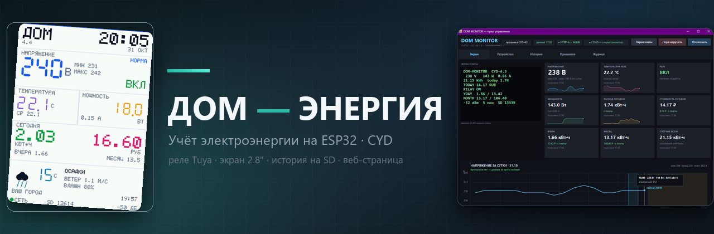
</p>

<h1 align="center">Дом — энергия 🏠⚡</h1>

> **Выпуск 4.14 — 21.11.2026.** Один выпуск после 4.13: честные источник и
> возраст каждого показателя, настоящий комнатный климат за период, сравнение
> периодов, пики, бюджет и прогноз, экспорт CSV, события и диагностика,
> проверяемая запись на SD и ежедневный архив, Telegram-пинг, экран
> «СОСТОЯНИЕ» на плате и `DomMonitor.exe` без консоли.
> Полное описание — [docs/RELEASE-4.14.md](docs/RELEASE-4.14.md), история
> изменений — [CHANGELOG.md](CHANGELOG.md).

<p align="center">
  <strong>Учёт электроэнергии на ESP32-2432S028 (CYD)</strong><br>
  Реле Tuya · экран 2.8" · история на SD · веб-страница · программа для Windows
</p>

<p align="center">
  
  
  
  
</p>

<p align="center">
  <a href="#-возможности"><b>Возможности</b></a> ·
  <a href="#-скриншоты"><b>Скриншоты</b></a> ·
  <a href="#-установка"><b>Установка</b></a> ·
  <a href="#-программа-для-windows"><b>Программа для Windows</b></a> ·
  <a href="#-home-assistant-mqtt-и-автообнаружение"><b>Home Assistant</b></a> ·
  <a href="#-все-команды"><b>Команды</b></a> ·
  <a href="#-все-http-эндпоинты"><b>HTTP</b></a> ·
  <a href="#-лицензия"><b>Лицензия</b></a>
</p>

> Это не «умный дом» на сто устройств и не облачный сервис. Одна плата,
> одно реле, одна карта памяти. Всё, что нужно для учёта, работает локально;
> интернет — только для мощности из облака Tuya и погоды.

---

## 🖼 Скриншоты

По одному кадру с каждого контура (4.14, живые данные):

<p>
<a href="docs/screenshots/4.14/web/01-главная-десктоп.png">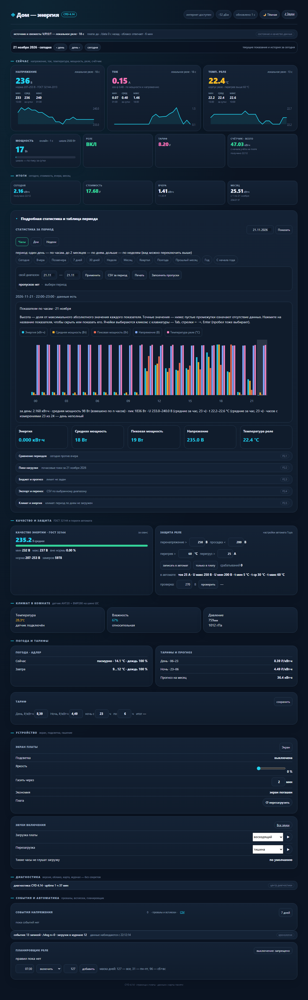</a>
<a href="docs/screenshots/4.14/pc/07-период-сравнение-и-пики.png">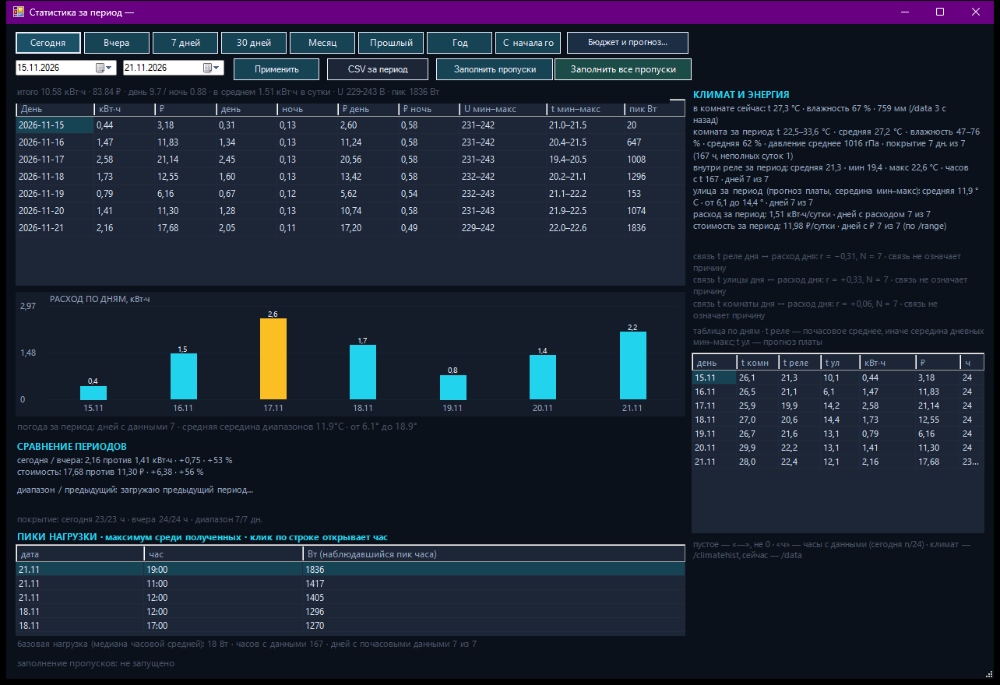</a>
</p>
<p>
<a href="docs/screenshots/4.14/board/01-главный@2x.png">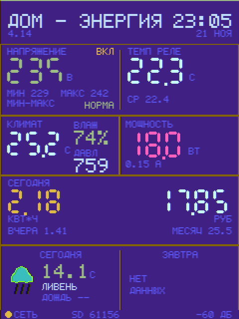</a>
<a href="docs/screenshots/4.14/board/05-сегодня@2x.png">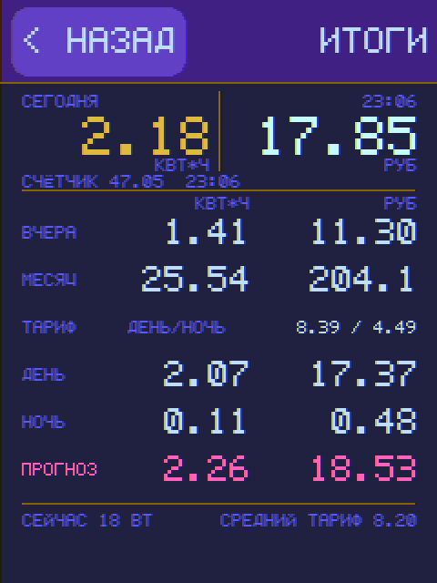</a>
<a href="docs/screenshots/4.14/board/09-состояние@2x.png">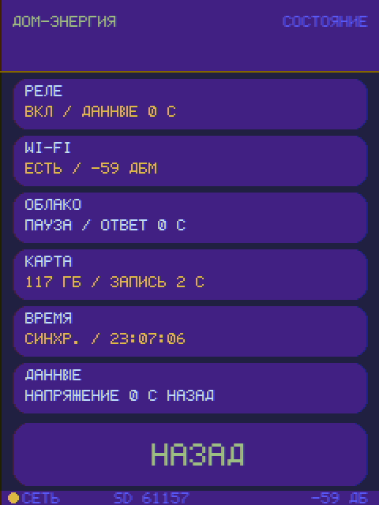</a>
</p>

Все кадры 4.14 — 15 по вебу (включая печать в PDF), 18 по приложению и
30 по экрану платы — лежат в [`docs/screenshots/4.14/`](docs/screenshots/4.14/).
Кадры прошлых выпусков — в [`docs/screenshots/`](docs/screenshots/).

## 🆕 Что нового в 4.14 (21.11.2026)

Один выпуск после 4.13 (11.11.2026): всё, что сделано с 11 по 21 ноября. Прошивка
**4.14**, сборка `6fe4b87d3a861ba37f1f`, образ 1 630 192 Б (82,9 % слота).
Страница `/` — ~86,3 КБ (86 331 Б отдаётся) Б, HTTP-эндпоинтов 53, экранов устройства 10
(девять доступны). Подробно — [docs/RELEASE-4.14.md](docs/RELEASE-4.14.md)
и [CHANGELOG.md](CHANGELOG.md).

### Источник, возраст и честные нули
- **Новый `/measure`**: у напряжения, мощности, тока и температуры есть
  `source` (`local` / `cloud` / `none`), `ageSec` и `ttlSec`. На странице и
  в приложении видно «локальное реле · 14 с», «облако · N с», «устарело»,
  «нет свежих данных»; при `source=none` крупное число — «—», а не 0.
  `ageSec = -1` означает «значение не приходило ни разу».
- **`/data`**: `vSeen`, `pSeen`, `tSeen`, `stale` — не полученное значение
  больше не выглядит нулём. В `/range` добавлены `vvalid`/`tvalid`: реальный
  0 °C отличается от пропуска.
- **`null` — это пропуск, а не ноль** во всей истории: график рвётся,
  неполные дни помечаются, средняя мощность взвешивается по числу измерений.

### История и период
- **24 ячейки истории всегда существуют**: выбирается любая, включая пустую
  (показывает «нет измерений»); работает мышью, `←`/`→` и `Enter`.
- **Один блок «Подробная статистика и таблица периода»**: 12 пресетов, свой
  диапазон, вид «Часы · Дни · Недели», легенда-переключатель, карточки,
  таблица, печать.
- **Сравнение периодов**, **топ-5 пиков нагрузки**, **бюджет и прогноз**
  (лимит хранится в браузере/настройках приложения), **экспорт CSV**
  с единицами и BOM — без выдуманных чисел и с пометкой «оценка».
- `/range` и `/history` — асинхронные: 202/pending, «прочитано N КБ»,
  страница не выглядит зависшей.

### Климат
- **`GET /climatehist?from=&to=`** — настоящий комнатный климат за период:
  по дням `n`, температура/влажность мин/макс/средняя, давление. Веб и
  приложение показывают «комнату за период», покрытие «N из M дней» и
  корреляции с расходом («связь не означает причину»).
- **Окно КЛИМАТ на плате**: кнопки **T / H / P** — график по температуре,
  влажности, давлению; спокойная шкала (минимум размаха 4 °C / 12 % / 8 мм).

### SD, архив, сохранность
- **Каждая запись на карту проверяется**; `/storage` отдаёт `writeOk`,
  `writeFail`, возраст записи и ошибки. Месячные файлы **не удаляются по
  возрасту**; после обрыва питания история восстанавливается из `.bak`.
- **`/repair?dedupe=1`** убирает дубли (на живой карте: 8 358 дублей,
  осталось 43 338 строк).
- **Ежедневный проверяемый архив на ПК** (`DomEnergy-DailyArchive`,
  SHA-256 + gzip) и вкладка **«Архив»** в приложении с тестом
  восстановления.

### Приложение Windows
- **Графики на .NET Chart**: энергия столбиками, напряжение линией,
  температура полосой, сравнение с вчера, день/ночь, экспорт PNG.
- **Быстрая история**: вчера предзагружается, дни кэшируются, «загрузка
  истории…» вместо «нет данных».
- **Новые вкладки «Терминал» и «Архив»**, бюджет и прогноз, CSV, климат
  и энергия, источник и возраст показателей, «Экран платы» — рисуемая копия.
- **Единый `DomMonitor.exe` без консоли**; супервизор держит приложение и
  пинг-бота; трей работает и после скрытия окна.
- **Telegram-пинг**: слово «пинг» — и бот присылает состояние платы.
  Только чтение, только один личный чат, токен не в репозитории.

### Плата и прошивка
- **Экран «СОСТОЯНИЕ»**: реле, Wi-Fi, облако, карта, время, возраст данных.
  Вход — тап по правой части шапки главного, выход — по шапке/«НАЗАД».
- **Управление закрыто ключом `X-Dom-Key`**, доверенные корни TLS — в
  `trusted_roots.h`; OTA только из приложения, с манифестом и проверкой.
- **`pageCut` вылечен** для обычной нагрузки: 20 из 20 загрузок страницы
  (~86 КБ) целиком; дедлайны отправки в `bounded_web_server.h`.
- **`/stage`** — этап `loop()`, переживший панику; **`/weather` и
  `/forecast`** — диагностика погоды без serial; **`/shot`** — снимок TFT
  (только в отладочной сборке).
- Звук в правильном темпе, инверсия панели по умолчанию, редактор тарифа.

**История выпусков:** [4.13](CHANGELOG.md) — шесть скинов и единый шрифт,
экран настроек, быстрая страница, `DomMonitor.exe`; 4.12 — период, тарифы,
звуки, датчик AHT20+BMP280. Полные списки — в [CHANGELOG.md](CHANGELOG.md).

## 🆕 Что нового в 4.12 (08.11.2026)

**Статистика за период** — 12 пресетов плюс свой диапазон; расход, стоимость,
день/ночь, среднее в сутки, U, пик мощности, таблица по дням с погодой, CSV и
печать. **Тарифы с историей** — старые дни считаются по тарифу того дня, смена
цены не переписывает начисленное (`/tariff`). **Погода по дням** —
`/weather.csv`. **Уведомления** — одно сообщение на эпизод, восстановление,
алерт защиты, гистерезис порогов, ежедневная сводка (`tgDaily`).

## 🔌 Датчик AHT20 + BMP280: установка

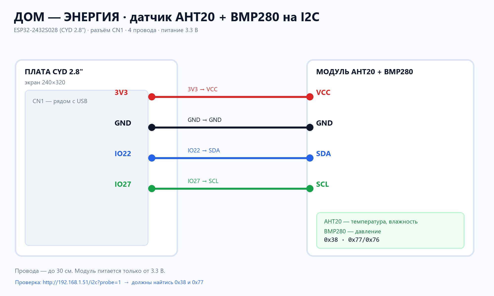

Модуль I2C с AHT20 (температура и влажность) и BMP280 (давление) —
**[модуль датчиков на Ozon](https://ozon.ru/t/cFEb2Dn)**. Модуль питается
**только от 3.3 В**, 5 В подавать нельзя.

| Модуль | Плата CYD (разъём CN1, он же «Расширение 02») | Пин платы |
|---|---|---|
| VCC / VDD | 4 | 3V3 |
| GND | 1 | GND |
| SDA | 2 | IO22 |
| SCL | 3 | IO27 |

> Порядок SDA/SCL не критичен: прошивка при старте пробует оба варианта и
> запоминает рабочий (в `/i2c` видно `sda`/`scl`). «P3» и «Расширение 01»
> не подойдут: там нет 3.3 В, IO35 — только вход, IO21 занят подсветкой.

Порядок установки:

1. Обесточьте плату.
2. Четыре провода «мама-мама» до 30 см по таблице выше.
3. Включите плату и откройте `http://192.168.1.51/i2c` — в поле `found`
   должны быть `[56,119]` (0x38 — AHT20, 0x77 — BMP280). Если модуль не
   виден: `/i2c?probe=1`, затем `/i2c?init=1` и `/i2c?slow=1`.
4. Климат появится на главном экране (карточка «КЛИМАТ») и на странице.

<p>
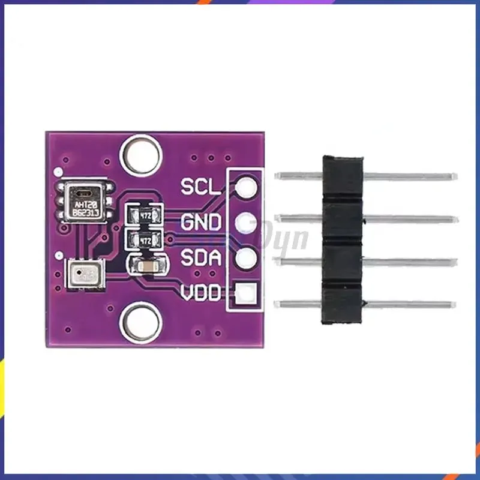
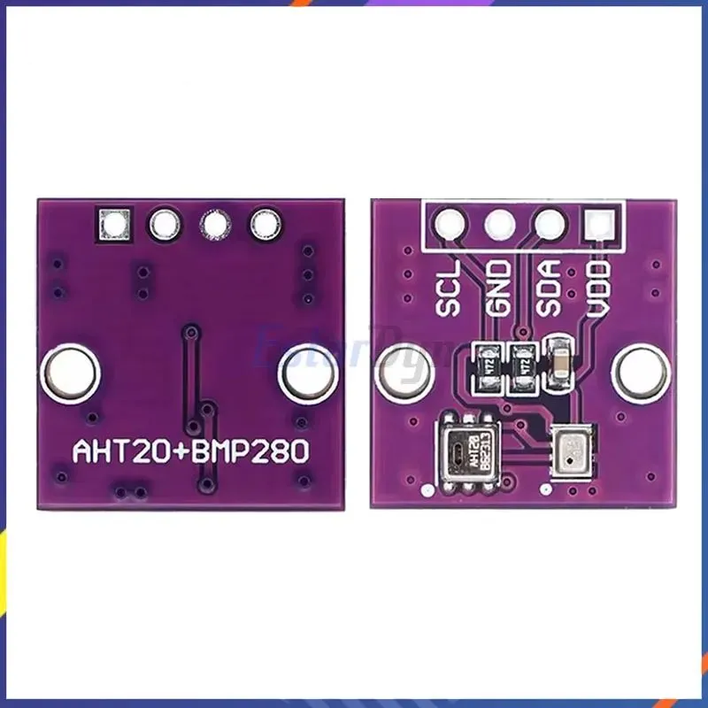
</p>

**Что с данными.** В `/data` — `eok`, `et`, `eh`, `ep`, `envAge` (секунд с
последнего чтения; `eok=0`, если данных нет дольше 5 минут). Раз в час
значения пишутся в `/climate.csv` (`дата,время,t,h,p`) — одна строка на
час, без дублей, мусорное давление отбрасывается. Файл отдаётся через
`/full?file=climate.csv`, виден в `/files`; `GET /climate?clean=1` чистит
журнал, `GET /climatehist` отдаёт климат за период.

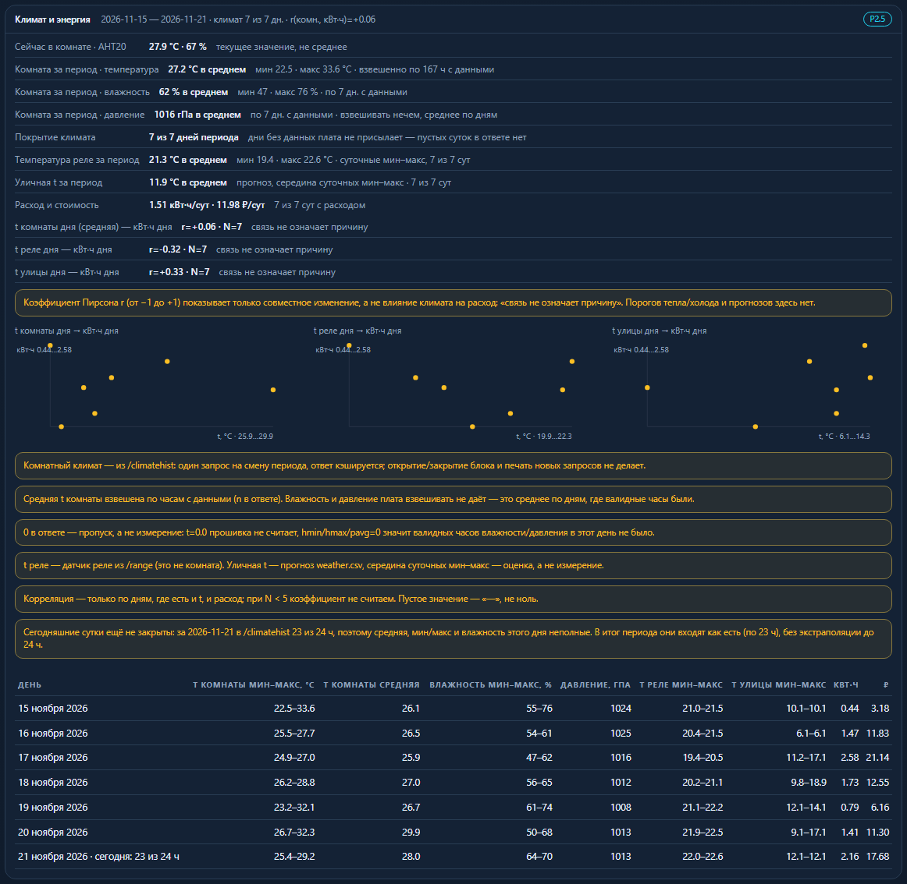

Купить: [AHT20 + BMP280 I2C модуль датчиков](https://ozon.ru/t/cFEb2Dn)
### Динамик

Мини-громкоговоритель **35 × 25 × 6.3 мм, 8 Ом, 2 Вт**, модель `YDSB-3525-8R2W-2P1.25`,
с разъёмом 2 pin 1.25 мм — встаёт в штатный разъём **P4 (Speaker)** на плате.

<p>
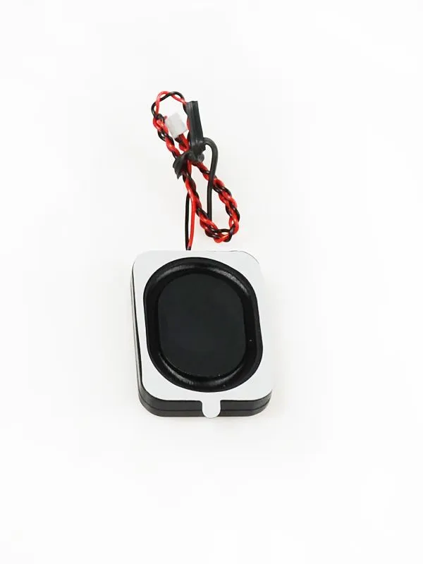
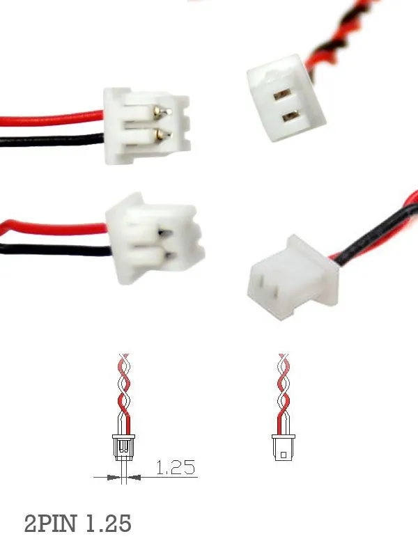
</p>

| Динамик | Плата |
|---|---|
| «+» (красный) | P4, контакт IO26 |
| «−» (чёрный) | P4, GND |

Звук — ШИМ-тон на IO26, громкость 10 % по умолчанию (потолок 40 %). Настройка — `/sound.html`
или вкладка «Звуки» в приложении: 12 пресетов, событие → звук, тихие часы 22:00–08:00,
авария звучит всегда.

Купить: [Мини громкоговоритель 35×25×6.3, 8 Ом, 2 Вт](https://ozon.ru/t/sXNsfZ1)

## 🔊 Звуки (4.12)

Плата умеет звучать: 12 коротких пресетов в низком диапазоне (350–900 Гц),
выбор звука на каждое событие, громкость и тихие часы.

- **События**: загрузка, перезагрузка/OTA, завершение OTA, ошибка/защита,
  авария по напряжению или перегрузу, реле включилось/выключилось, начало часа,
  касание экрана.
- **Громкость**: 10 % по умолчанию, потолок 40 %; ночью (22:00–08:00) — 5 %.
  **Авария и перегруз звучат всегда**, даже в тихие часы и при приглушении.
- **Приглушение**: на 10, 30 или 60 минут.
- **Где настроить**: страница `http://<ip>/sound.html` или вкладка «Звуки» в
  приложении Windows; в вебе — кнопка «♪ Звуки» в шапке.
- **API**: `GET /sound` — настройки и список пресетов, `?vol=10&nvol=5`,
  `?mute=30`, `?quiet=0|1`, `?boot=11&error=10&relay_on=1…`, `/beep?preset=N`.

Подключение: динамик или пьезоизлучатель между **GPIO 26** и **GND**.

## 🆕 Что нового в 4.11 (06.11.2026)

- **Прошивка по Wi-Fi (OTA) наконец работает.** Схема разделов заменена на `min_spiffs`
  (два слота по 1.875 МБ); обновление проверено на живой плате — `boots.log` пишет `rr=OTA`.
- **Защита живёт в автомате Tuya.** Пороги напряжения, тока и температуры пишутся прямо
  в устройство (`alarm_set_1/2`), поэтому срабатывают даже когда плата выключена.
  Наша защита осталась вторым слоем.
- **Журнал провалов и всплесков** напряжения: время, значение, длительность, файл `/voltage.log`.
- **Отчёт по ГОСТ 32144**: среднее, мин/макс, доля замеров вне 207–253 В.
- **Планировщик реле**: до 8 правил (время, вкл/выкл, маска дней) в вебе и приложении.
- **MQTT-команды уставок** и разрешения на выключение.
- **Приложение**: вкладка «Защита» с теми же настройками, значок в трее с мощностью,
  автопоиск платы в сети, окно планировщика.
- **Неделя и CSV** в веб-странице.

## 📑 Содержание

- [🖼 Скриншоты](#-скриншоты)
- [💡 Что это и зачем](#-что-это-и-зачем)
- [🔌 Из чего состоит](#-из-чего-состоит)
- [⚡ Возможности](#-возможности)
- [📐 Как это работает](#-как-это-работает)
- [🖥 Экран платы и рабочий процесс](#-экран-платы-и-рабочий-процесс)
- [🔆 Экран, светодиод и динамик](#-экран-светодиод-и-динамик)
- [🎛 Все команды](#-все-команды)
- [🌐 Все HTTP-эндпоинты](#-все-http-эндпоинты)
- [🔧 Установка](#-установка)
- [💻 Программа для Windows](#-программа-для-windows)
- [☁ Восстановление истории из облака](#-восстановление-истории-из-облака)
- [🔒 Какие данные публикуются, а какие нет](#-какие-данные-публикуются-а-какие-нет)
- [🚀 Быстрый старт](#-быстрый-старт)
- [📁 Структура репозитория](#-структура-репозитория)
- [✅ Тесты](#-тесты)
- [⚠ Ограничения](#-ограничения)
- [👤 Разработчик](#-разработчик)
- [🤝 Как помочь проекту](#-как-помочь-проекту)
- [📄 Лицензия](#-лицензия)

---

## 💡 Что это и зачем

Домашний счётчик показывает только «сколько накрутило». Не видно, **когда**
был скачок напряжения, **сколько** реально потребляет чайник или перфоратор,
**какая** температура у реле и **сколько** это стоит по дневному/ночному
тарифу.

Этот проект закрывает именно эти вопросы:

- реле Tuya измеряет напряжение, ток и накопленную энергию;
- плата раз в 15–30 секунд забирает показания и раскладывает их по часам;
- история пишется на microSD и не пропадает при отключении интернета;
- на экране — пять окон с графиками и итогами;
- в браузере — та же история, но с нормальными графиками и подсказками.

Проект вырос из практики: несколько недель ушло на протокол Tuya, «застывшую»
мощность, порядок строк в CSV и тачскрин. Порядок строк в CSV и тачскрин — частая причина ошибок.

---

## 🔌 Из чего состоит

| Компонент | Что именно | Примечание |
|---|---|---|
| Плата | **ESP32-2432S028** (CYD) | ESP32-D0WD-V3, 4 МБ flash, экран ILI9341 2.8" 240×320, тач XPT2046, слот microSD |
| Реле | Tuya Wi-Fi реле напряжения | измеряет напряжение/ток/энергию; **не входит** в репозиторий |
| Карта | microSD, FAT32, 8–32 ГБ | история `/energy.csv` |
| Питание | USB 5 В, 1 А | кабель с передачей данных |
| Wi-Fi | 2,4 ГГц | ESP32 не умеет 5 ГГц |
| ПК | Windows, опционально | бэкапы, архив прошивок, GUI |

**Схема подключения:** всё уже на одной плате. Внешних проводов нет —
только USB-питание и карта microSD. Реле подключается **не проводом**, а по
Wi-Fi (TCP 6668).

### Где купить

| Что | Где | Ссылка |
|---|---|---|
| **Плата с экраном** — ESP32 + TFT 2.8" + тач + microSD | AliExpress | [TENSTAR ESP32 с дисплеем 2.8"](https://aliexpress.ru/item/1005007280879338.html) |
| **Та же плата** | Ozon | [ESP32-2432S028](https://ozon.ru/t/LCmnIGD) |
| **Корпус под экран** | AliExpress | [корпус для CYD](https://ali.click/c6g2p14) |
| **Умное реле напряжения, тока и утечки тока с WiFi на DIN рейку с дисплеем** | Ozon | [Tuya умное реле (автомат) на DIN-рейку](https://ozon.ru/t/3QthrpD) |
| Карта microSD 8–32 ГБ | любой магазин | класс 10, FAT32 |

> **Важно при покупке платы.** Нужна именно **ESP32-2432S028** (её называют CYD —
> «Cheap Yellow Display») с **резистивным тачскрином** и **слотом microSD**.
> Встречаются похожие платы без слота карты или с ёмкостным экраном — они
> не подойдут без изменения прошивки.
>
> **Про реле.** Подойдёт Tuya-реле с измерением мощности (DP `phase_a` —
> напряжение, ток, накопленная энергия). Дешёвые реле без замера мощности
> покажут только состояние ВКЛ/ВЫКЛ и энергию не посчитают.

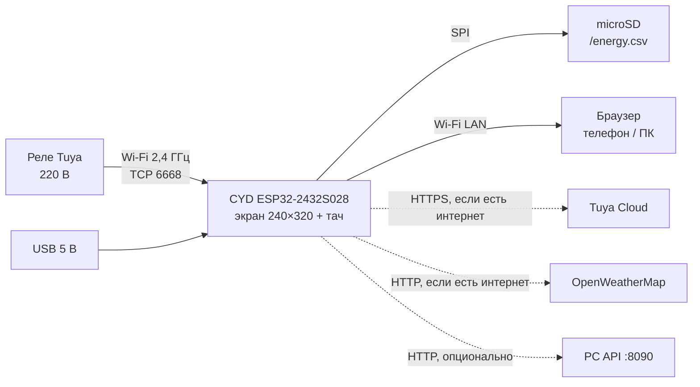

Подробная распиновка — [docs/WIRING.md](docs/WIRING.md). Отдельная схема
пайки не нужна: это моноблок, все соединения уже разведены на заводе.

---

## ⚡ Возможности

- **Плата и десять экранов** — главный, напряжение, темп реле, мощность,
  итоги, погода, климат, настройки и **состояние**; сторож в коде отключён.
  Переключение — касанием карточки или шапки.
- **История на microSD** — строка раз в 30 секунд, ~2880 строк в сутки,
  автоматическая ротация по месяцам (`/energy-YYYY-MM.csv`) **без удаления**
  прошлых месяцев; каждая запись проверяется, ошибки видны в `/storage`.
- **Графики по часам за любой день** — с мин/сред/макс, пиками мощности и
  «вне нормы»; 24 ячейки выбираются мышью и клавиатурой.
- **Пики мощности — когда случился и сколько длился**: на экране
  `ПИК 1117 ВТ / 16:53  3 МИН`, на странице — подсказка с длительностью.
- **Веб-страница в памяти платы** — адаптивная, 86 КБ, с графиками,
  подсказками, историей за период, **сравнением периодов, пиками, бюджетом
  и прогнозом, экспортом CSV, климатом и энергией, событиями и диагностикой**;
  работает с телефона и компьютера.
- **Источник и возраст каждого показателя** — `/measure`: «локальное реле ·
  14 с», «облако · N с», «устарело», «нет свежих данных». Пропуск не
  выдаётся за ноль.
- **Комнатный климат** — AHT20 + BMP280: температура, влажность, давление;
  на плате кнопки **T/H/P**, за период — `GET /climatehist`.
- **Управление подсветкой** — выключение на ночь (`DISP OFF`), яркость 0–100 %,
  пробуждение касанием на 20 секунд. Настройка живёт в памяти платы.
- **Светодиодная индикация состояния** — сеть, реле, карта, интернет,
  погашенный экран, загрузка.
- **Звуковые сигналы на динамик** — тревога по напряжению и перегреву,
  12 пресетов, тихие часы.
- **Работа без интернета** — локальное реле, экран и запись на карту
  продолжают работать; пропадают только облако и погода.
- **Дозаполнение истории из облака** — пропущенные часы восстанавливаются
  (команда `CSVHIST` или автоматически в 02:00).
- **Проверяемый архив** — `pc/archive-run.ps1` + задача
  `DomEnergy-DailyArchive`: снимки SD с SHA-256 и gzip, без срока удаления;
  в приложении — вкладка «Архив» и тест восстановления.
- **Telegram-пинг** — бот отвечает состоянием платы на слово «пинг»;
  только чтение, только один личный чат.
- **Программа для Windows** — графики, история, период, климат, архив,
  терминал, прошивка; один `DomMonitor.exe` без консольного окна.
- **Диагностика по serial и HTTP** — `STATUS`, `DIAG`, `CSV`, `RAW`,
  `CALTOUCH`, `IMP` и другие команды; `/stage`, `/weather`, `/forecast`,
  `/clog`, `/netdiag`, обезличенный отчёт.
- **Без пайки** — CYD уже содержит экран, тач и слот карты.

---

## ✅ Как проверить за 5 минут

| Что проверить | Как | Ожидаемый результат |
|---|---|---|
| Плата жива | открыть `http://192.168.1.51/` | страница с карточками, версия **CYD-4.14** |
| Данные идут | `http://192.168.1.51/data` | `v` около 230–245, `e` растёт, `fw` = `4.14`, `build` = `6fe4b87d…` |
| Источник и возраст | `http://192.168.1.51/measure` | у V/P/I/T есть `source` (`local`/`cloud`/`none`) и `ageSec` |
| Карта пишет | `http://192.168.1.51/storage` | `writeOk` растёт, `writeFail=0`, свободное место в ГиБ |
| Климат за период | `…/climatehist?from=2026-11-11&to=2026-11-17` | `ok:true`, дни по возрастанию, `n ≤ 24` |
| ГОСТ | `http://192.168.1.51/gost` | `n` растёт, `badPct` маленький |
| События | `http://192.168.1.51/vlog` | список провалов/всплесков (может быть пустым) |
| Защита | `http://192.168.1.51/protect` | `on`, `vmax`, `a1`, `a2` в base64 |
| Сухой прогон защиты | `…/protect?test=270` | `"test":{"action":"перенапряжение"}` |
| Планировщик | `…/sched` | `{"cnt":0,"allowOff":0,"rules":[]}` |
| Автомат Tuya | `…/tuya` | `a1`/`a2` — те же base64, что в приложении Tuya |
| Погода | `…/weather` и `…/forecast` | `http=200`, `err=0`, время и `maxAlloc` |
| Этап цикла | `…/stage` | текущий и прошлый этап `loop()` |
| OTA | приложение → «Прошивка» → «Прошить по Wi-Fi» | ответ `OK`, в `boots.log` — `rr=OTA` |
| Приложение | вкладки «Экран», «История», «Архив», «Терминал» | значения совпадают с веб-страницей |

⚠️ Пороги в автомате — боевые: запись `250 В` реально изменит защиту автомата.
Управляющие запросы (`/reboot`, `/tap`, `/protect?apply=1`, `/gapfill?run=1`)
требуют заголовок `X-Dom-Key`; чтение данных открыто в доверенной LAN.

## 📐 Как это работает

1. **Локально.** Плата подключается к реле по TCP 6668 (протокол Tuya 3.5,
   AES-GCM) и забирает DP 1 (энергия), DP 6 (напряжение/ток/мощность),
   DP 16 (реле), DP 101 (температура).
2. **Облако.** Если есть интернет, раз в минуту запрашивается
   `openapi.tuyaeu.com`: там `phase_a` свежее, чем локальный DP 6. Это
   особенно важно для мощности.
3. **Карта.** Раз в 30 секунд — строка CSV. Без напряжения, времени или
   счётчика строка не пишется: лучше пропуск, чем нуль.
4. **Экран и веб.** Экран обновляется по «сигнатуре» данных (без мерцания),
   страница опрашивает `/data` каждые 3 секунды.
5. **Страница.** Собирается потоково: значения лежат в массиве, тело пишется
   в сокет одним проходом из PROGMEM, CSS и JS — отдельными ресурсами
   (`/app.css`, `/app.js`, `/history.js`, `/control.js`) с кэшем и версией
   в URL. Это занимает 4 мс и не держит 86 КБ в куче — иначе mbedTLS не
   хватает памяти для TLS к облаку.
6. **Архив и контроль.** Каждая запись на карту проверяется, `/storage`
   показывает счётчики ошибок. Раз в сутки ПК снимает проверяемый архив SD
   (SHA-256 + gzip); восстановление — только в отдельную папку.

Почему мощность — больное место: у реле **нет отдельной точки «мощность»**.
Она приходит в `phase_a` из облака или в DP 6 локально, но локальный DP 6
иногда отдаёт устаревшее значение. Поэтому в прошивке есть приоритет
источников и пометка «stale». Подробности — [docs/АРХИТЕКТУРА.md](docs/АРХИТЕКТУРА.md).

---

## 🖥 Экран платы и рабочий процесс

Скриншоты в репозитории сняты в разное время: веб-страница 4.14 — свежая
(в `docs/screenshots/4.14/web/`), экраны платы — 30.10.2026 (прошивка 4.3,
сами окна не менялись). С 4.13 появился экран настроек, с 4.14 — экран
**«СОСТОЯНИЕ»** и изменённая карточка климата на главном; кадры 4.14 для
платы и приложения готовятся отдельно. На снимках тестовые показания — у вас
будут свои. Координаты погоды задаются в `secrets.h` (`WEATHER_LAT` /
`WEATHER_LON`).

> Версия в репозитории и в прошивке одна — **4.14**; страница, приложение и поле `fw` в `/data` показывают её из одного источника.

С 4.14 экранов **десять определены, девять доступны**:

| Экран | Как открыть | Что на нём |
|---|---|---|
| ГЛАВНЫЙ | — | карточки: напряжение, климат, мощность, «сегодня», погода; график и погода |
| НАПРЯЖЕНИЕ | тап по карточке | мин/сред/макс, «вне нормы», график по часам |
| ТЕМП РЕЛЕ | тап по правой половине карточки напряжения | корпус реле: макс/сред/мин, график |
| МОЩНОСТЬ | тап по карточке | мгновенная, средняя, пик, ток |
| ИТОГИ | тап по «СЕГОДНЯ» | сегодня/вчера/месяц, тариф, день/ночь, прогноз |
| ПОГОДА | тап по карточке | температура, осадки, ветер, влажность |
| КЛИМАТ | тап по карточке | комната: t, влажность, давление; **T/H/P**, график, выбор часа |
| НАСТРОЙКИ | тап по **левой** части шапки главного | СКИН, ЯРКОСТЬ, ЗВУК, ТИХИЕ ЧАСЫ |
| СОСТОЯНИЕ | тап по **правой** части шапки главного | РЕЛЕ, WI-FI, ОБЛАКО, КАРТА, ВРЕМЯ, ДАННЫЕ |
| СТОРОЖ | — | в коде есть, отключён (`WD_UI 0`) |

Для каждого экрана ниже — две картинки: **с подписями** (рамка и номер на
каждой зоне, пояснение в поле справа) и без них. Обе сняты с одной и той же
прошивки, подписи стоят вне экрана и не закрывают показания.

### Главный экран — карточки и две точки в шапке


*На картинке: рамка и номер — нажимаемая зона, справа — что она показывает. Ниже тот же экран без подписей.*


**Что показывает.** Сверху — имя «ДОМ — ЭНЕРГИЯ», версия, время и дата.
Ниже карточки:

| Карточка | Что на ней | Куда ведёт касание |
|---|---|---|
| НАПРЯЖЕНИЕ | напряжение, мин/макс, «ВКЛ»; справа — температура корпуса реле | левая половина — окно «НАПРЯЖЕНИЕ», правая — «ТЕМП РЕЛЕ» |
| КЛИМАТ | воздух крупно, ниже влажность и давление | окно «КЛИМАТ» |
| МОЩНОСТЬ | Ватты и ток | окно «МОЩНОСТЬ» |
| СЕГОДНЯ | кВт·ч, рубли, вчера и месяц | окно «ИТОГИ» |
| ПОГОДА | температура, осадки, ветер, влажность | окно «ПОГОДА» |

Внизу — статус: зелёная точка «СЕТЬ», число строк на карте (`SD …`) и
уровень сигнала. Если карты нет — «НЕТ SD», если Wi-Fi нет — «НЕТ WI-FI».

**Сценарий.** Включаете плату → ждёте 10–30 секунд (Wi-Fi + NTP) → на
главном появляются значения. Дальше нажимаете карточку. Возврат — верхняя
полоса «‹ НАЗАД» в любом окне.

> С 4.13 тему (скин) и яркость можно менять с самой платы: тап по левой части шапки
> главного открывает «НАСТРОЙКИ», тап по правой с 4.14 — экран
> «СОСТОЯНИЕ». Смены Wi-Fi с экрана по-прежнему нет: сеть задаётся через
> мастер настройки или `WIFISET` — так меньше шансов случайно остаться без
> связи.

### Окна: напряжение, темп реле, мощность, итоги, погода

<p>
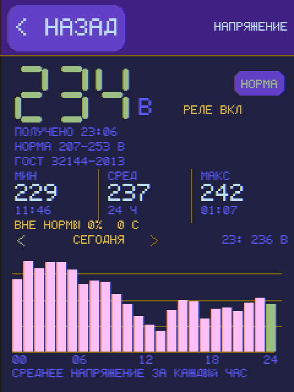
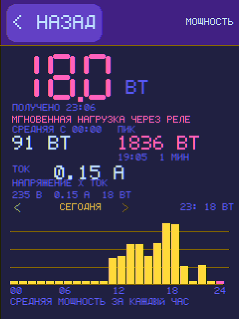
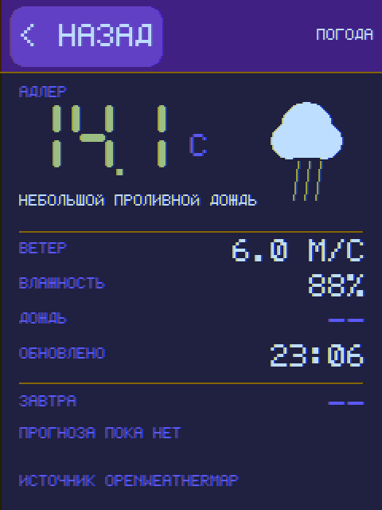
</p>

| Окно | Что показывает | Что важно знать |
|---|---|---|
| **НАПРЯЖЕНИЕ** | текущее, мин/сред/макс с временем, «ВНЕ НОРМЫ %», график по часам | норма 207–253 В по ГОСТ 32144-2013; ниже 190 или выше 265 — «АВАРИЯ»; `‹ ›` листают дни (до 60 назад), тап по дате — вернуться к сегодня, тап по столбику — значение часа |
| **ТЕМП РЕЛЕ** | температура **корпуса** реле, макс/сред/мин, график | это не воздух в комнате; подпись стоит специально, чтобы не путать с погодой |
| **МОЩНОСТЬ** | мгновенная, средняя с 00:00, пик и его длительность, ток | средняя не учитывает неполный текущий час; длительность пика — сколько час был не ниже 80 % от пика (по записям раз в 30 с, поэтому округляется до минуты); строка «напряжение × ток» — проверка |
| **ИТОГИ** | сегодня/вчера/месяц, тариф, день/ночь, прогноз | прогноз — **оценка** `сегодня × 24 / прошедшие часы`, а не обещание; стрелок нет — это сводка |
| **ПОГОДА** | температура, описание, осадки, ветер, влажность, источник | OpenWeatherMap по координатам из `secrets.h`; нет интернета — «НЕТ ДАННЫХ» и «ПРОВЕРЬТЕ WI-FI» |

Если данных за день нет, окно честно пишет **«НЕТ ДАННЫХ»**, а не рисует
нули: мин/сред/макс — `--`. Лучше пустота, чем ложный график.


**Сценарий.** Главный → карточка → окно. Стрелки **‹ ›** листают дни,
нажатие на дату возвращает к сегодняшнему, нажатие на столбик показывает
значение этого часа. Возврат — полоса «‹ НАЗАД».

**Погода за период** (в вебе и приложении) берётся из `/weather.csv` и
таблицы периода; в приложении в строке состояния — «сейчас» и прогноз на
завтра.
### Калибровка тача — только по serial


**Что показывает.** Экран калибровки: «КАЛИБРОВКА», «УГОЛ 1 ИЗ 4», «НАЖМИ В
ЦЕНТР КРУЖКА» и мишень в левом верхнем углу.

**Сценарий.** USB → монитор порта **115200** → команда `CALTOUCH` → нажать
четыре мишени по очереди (левый верх, правый верх, левый низ, правый низ).
После четвёртой — «ГОТОВО», значения в NVS. `CAL` — показать коэффициенты,
`CALRESET` — сбросить и перезагрузить.

С экрана калибровку запустить **нельзя**, хотя экран «НАСТРОЙКИ» с 4.13 есть:
в нём только СКИН, ЯРКОСТЬ, ЗВУК и ТИХИЕ ЧАСЫ. Это сделано специально, чтобы
случайное касание не сбило коэффициенты.

### Веб-страница — та же история, но удобнее

> Скриншоты ниже — 4.12; в 4.14 страница перестроена (см. таблицу кадров в
> начале README и [docs/RELEASE-4.14.md](docs/RELEASE-4.14.md)).

На компьютере:


На телефоне:


**Что показывает.** Сверху — версия `CYD-4.14`, состояние сети, RSSI и
«обновлено N с», кнопка темы и «Звуки». Дальше — карточки «Сейчас»
(напряжение, мощность, ток, температура) с источником и возрастом, итоги,
климат, качество энергии и защита, панель «Состояние и качество данных».
Ниже — свёрнутый блок **«Подробная статистика и таблица периода»**:
12 пресетов, свой диапазон, вид «Часы · Дни · Недели», график с
легендой-переключателем, карточки, таблица, сравнение периодов, пики
нагрузки, бюджет и прогноз, экспорт CSV, климат и энергия, события и
диагностика.

**Сценарий.** Открыли `http://<IP-платы>/` → страница сама обновляет
`/data` каждые 3 секунды и мощность раз в 1,5 с. Раскрыли блок периода —
загрузились «Часы · сегодня»; нажали «7 дней» — график перестроился.
Навели на столбик — подсказка с точными значениями:

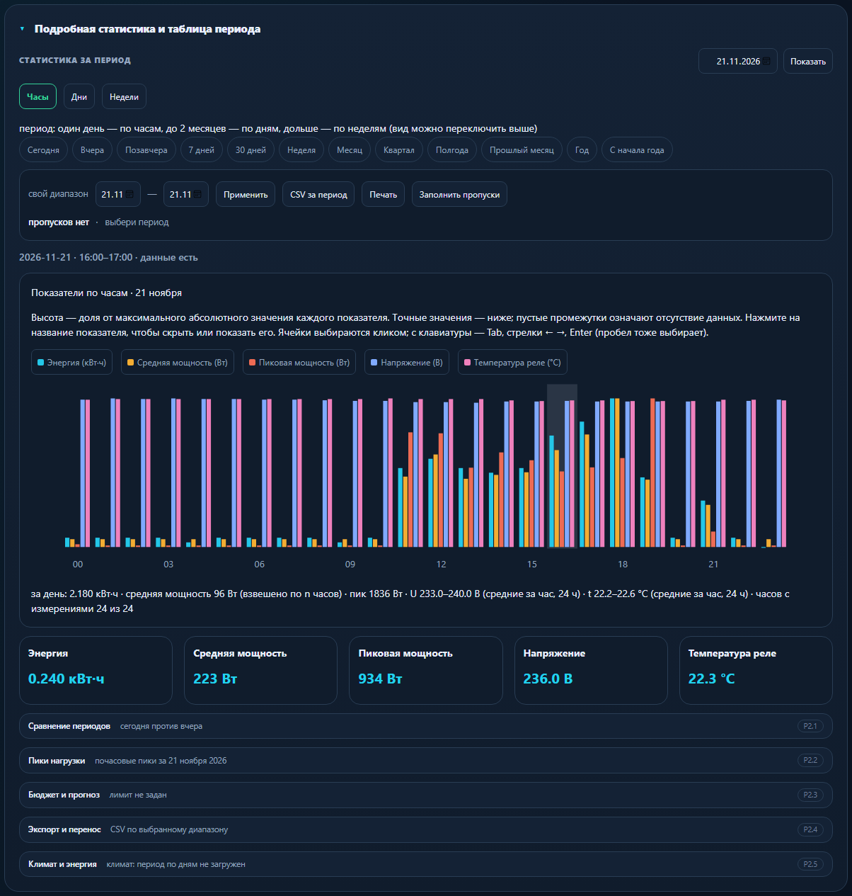

«11:00–12:00, средняя 158 Вт, пик 561 Вт в 11:47, длился 4 мин, 0.16 кВт·ч» —
видно и фон, и всплеск, и когда именно он был. В 4.14 у каждого часа
показаны все три величины, выбор часа работает и с клавиатуры.

**Почему у мощности две шкалы.** Раньше средняя и пик рисовались на одной
шкале 0–1000 Вт: средняя 150 Вт выглядела почти нулём, а пик 900 Вт —
огромным. Теперь сверху шкала средней (0–200 Вт), снизу — пика (0–900 Вт):


Сверху — «до» (общая шкала), снизу — «после» (две шкалы). Это не косметика:
раньше непонятно было, что именно происходит в обычные часы.

**Безопасность.** Чтение данных в локальной сети открыто — у страницы нет
пароля. Изменяющие действия (`/reboot`, `/tap`, OTA, `/repair`,
`/gapfill?run=1`) требуют ключ `X-Dom-Key`; без ключа управление закрыто
(HTTP 503). Не пробрасывайте порт платы в интернет: HTTP внутри LAN не
шифруется, для удалённого доступа — только VPN. Обезличенный отчёт из
блока «Диагностика» не содержит IP, MAC, SSID, токенов и device id.

---

## 🔆 Экран, светодиод и динамик

Настраивается по serial (подсветка — ещё и по HTTP), хранится в NVS.

### Подсветка экрана

GPIO 21, ШИМ 5 кГц / 8 бит — яркость плавная, а не «вкл/выкл».

```text
DISP            состояние: DISP: on=1 bright=255
DISP ON         включить (яркость 255)
DISP OFF        выключить: экран гаснет, тач продолжает работать
DISP 30         яркость 30 % → в ШИМ уходит 77 из 255
DISP TOGGLE     вкл/выкл — это шлёт кнопка «Экран платы» в приложении
DISP TOUCH      включить реакцию на касание
DISP NOTOUCH    отключить реакцию на касание
```

В NVS (namespace `disp`): `bright` — `0` выключено, `1–255` яркость; `touch` —
реакция на касание. Касание при погашенном экране включает подсветку на
20 секунд, повторное касание продлевает.

**Зачем.** Ночью подсветка 2.8" светит на всю комнату. С `DISP OFF` плата
работает дальше — пишет историю, читает реле, отдаёт страницу, — а состояние
видно по светодиоду. Проверено на плате: `DISP OFF` → `on:0, bright:0`;
`DISP ON` → 255; `DISP 30` → 77. `DISP TOGGLE` возвращает последнюю яркость,
но после перезагрузки «выкл» остаётся «выкл»: прошлая яркость в NVS не хранится.

| HTTP | Что делает |
|---|---|
| `GET /disp` | состояние: `{"ok":true,"on":1,"bright":255,"touch":1,"wake":0}` |
| `/disp?on=0` / `?on=1` | выключить / включить |
| `/disp?bright=30` | яркость в процентах, `0` — выключить |
| `/disp?touch=0` | отключить реакцию на касание |
| `/disp?wake=1` | «разбудить» на 20 секунд |

Поля в `/data`: `disp` (1/0), `bright` (0–255), `wake` (секунд до конца
пробуждения), `dtouch` (1/0 — будит ли касание).

### Светодиод — что означает цвет

| Цвет | Что значит | `/data led` |
|---|---|---:|
| Зелёный ровно | всё хорошо: сеть, реле, карта | 4 |
| Жёлтый ровно | нет интернета — локально, напряжение может быть устаревшим | 3 |
| Красный ровно | нет Wi-Fi или связи с реле (2 неудачи подряд) | 1 |
| Оранжевый мигает 1 Гц | нет SD-карты или 2 ошибки записи | 2 |
| Синий | загрузка (0–3 с), перед перезагрузкой | 0 |
| Зелёный тускло (20 %) | подсветка погашена | 5 |

Приоритет: **красный > оранжевый > жёлтый > зелёный**. Тусклый зелёный — «всё
хорошо», но экран погашен: ночью не слепит.

```text
LED            состояние: LED: green (net=1 relayFail=0 sd=1 sdw=0 dark=0)
LED TEST red   ... orange | yellow | green | dim | blue | off — на 15 секунд
LED RESET      вернуть автоматический режим
```

### Динамик — звуковые сигналы (4.12)

**Подключение:** GPIO 26 → «+» динамика, GND → «−». Пьезоизлучатель или
маленький динамик 8 Ом. Громкость по умолчанию **10 %**, жёсткий потолок 40 %.

**12 пресетов** (350–900 Гц, без «ультразвука»): тишина, тик, двойной тик, гонг,
восходящий, нисходящий, динь-дон, три коротких, щелчок, предупреждение, тревога, готово.

**Событие → звук** (настраивается): загрузка, перезагрузка/OTA, завершение OTA,
ошибка/защита, авария по напряжению или перегрузу, реле включилось, реле
выключилось, начало часа, касание экрана.

| Правило | Как работает |
|---|---|
| громкость | 10 % днём, 5 % в тихие часы (22:00–08:00) |
| авария и перегруз | звучат **всегда**, тишина и приглушение их не отключают |
| приглушение | на 10 / 30 / 60 минут, потом само снимается |

```text
BEEP                     состояние (on, vol, nvol, quiet, mute)
BEEP ON / BEEP OFF       включить / выключить звук
BEEP TEST                короткий «ок»
BEEP VOL 0..100          громкость (реально не выше 40)
BEEP PLAY 0..11          проиграть пресет
BEEP TOUCH / BEEP HOUR   звук на касание / начало часа
```

Настройка без консоли: страница **`http://<ip>/sound.html`** (в вебе — кнопка
«♪ Звуки»), вкладка «Звуки» в приложении Windows, API `GET /sound`.
Настройки — NVS `snd` (`vol`, `nvol`, `quiet`, `mute`, `e0…e8`).

---

## 🔌 Home Assistant, MQTT и автообнаружение

Плата умеет публиковать показания в MQTT-брокер и **сама сообщает Home Assistant, какие у неё датчики**. Ничего прописывать в `configuration.yaml` не надо: открыл HA — устройство уже там, со всеми сенсорами и в одной карточке.

### Что появляется в Home Assistant

| Датчик | Единица | Тип |
|---|---|---|
| Напряжение | V | sensor |
| Мощность | W | sensor |
| Ток | A | sensor |
| Температура реле | °C | sensor |
| Счётчик всего | kWh | sensor |
| Расход сегодня | kWh | sensor |
| Расход вчера | kWh | sensor |
| Расход за месяц | kWh | sensor |
| Стоимость сегодня | ₽ | sensor |
| Уровень Wi-Fi | dBm | sensor |
| Работает | s | sensor |
| Реле | — | binary_sensor |
| Сеть | — | binary_sensor |

Устройство в HA называется **«Дом — энергия»**, производитель NIKA SERVICE, модель `CYD-4.14 (ESP32-2432S028)`.

### Как включить — три шага

**1. Брокер.** В Home Assistant: `Настройки → Дополнения → Магазин → Mosquitto broker → Установить → Запустить`.

**2. Пользователь для MQTT.** `Настройки → Люди → Добавить пользователя` — например `mqtt` / свой пароль.

**3. Включить MQTT на плате.** Одной командой по HTTP — перепрошивка не нужна:

```text
http://192.168.1.51/mqtt?host=192.168.1.72&port=1883&user=mqtt&pass=ПАРОЛЬ
```

Настройки сохраняются в памяти платы и переживают перезагрузку. Выключить — `/mqtt?off=1`.

В Home Assistant останется добавить интеграцию: `Настройки → Устройства и службы → Добавить интеграцию → MQTT → Брокер` и указать адрес, порт и логин. После этого все 13 датчиков появятся сами.

### Дашборд

В комплекте — готовый дашборд **«Дом — энергия»**: показания сейчас, расход и стоимость, графики мощности, напряжения и температуры за 24 часа, столбики энергии за 7 дней.

### Команды

```text
relay_on     включить реле
relay_off    ЗАБЛОКИРОВАНО — отвечает off_blocked
refresh      обновить данные немедленно
```

**Выключение реле намеренно заблокировано.** Удалённо обесточить дом — слишком опасная операция для случайного нажатия. Включать — можно.

### Что публикуется в MQTT

Топики с префиксом `dom_energy`:

```text
dom_energy/state        все показания, JSON, раз в 30 с
dom_energy/status       online / offline (retained, LWT)
dom_energy/cmd          команды от Home Assistant
dom_energy/result       ответ на команду
homeassistant/sensor/dom_energy/<ключ>/config        описание датчика
homeassistant/binary_sensor/dom_energy/<ключ>/config
```

Всё — только в локальной сети. Наружу ничего не уходит.

### Диагностика

```text
GET /mqtt      состояние: включён, подключён, счётчики, последний топик
GET /data      поля mq, mqN, mqFail
MQTTSET "192.168.1.72" 1883 "mqtt" "пароль"     по serial
```

Если брокер недоступен — плата продолжает работать как обычно: экран, история, веб-страница. MQTT — дополнительный канал, а не замена.

### Требования к памяти

MQTT занимает около 3 КБ кучи; на 4.14 свободно 80–120 КБ в зависимости от нагрузки. Если брокер недоступен, плата работает как обычно.

---

## 🎛 Все команды

Все команды — по serial-монитору. Порт **115200**, строка до Enter, регистр не важен. Строки
`{"t":"data",...}` плата печатает сама — раз в цикл опроса и один раз при
старте; отдельной команды `DATA` нет, состояние по запросу отдаёт `STATUS`.

| Команда | Что делает |
|---|---|
| `STATUS` | JSON: `fw` (`4.14`), build, uptime, Wi-Fi, RSSI, IP, реле, карта, heap |
| `IP` | IP-адрес, SSID, RSSI |
| `DIAG` | диагностика: напряжение, пропуски, карта, облако |
| `NET` | сеть: Wi-Fi, IP, интернет, принудительное отключение |
| `NETOFF` / `NETON` | принудительно без интернета / проверить заново |
| `WIFIOFF` / `WIFION` | выключить / включить Wi-Fi |
| `WIFISET "сеть" "пароль"` | сменить Wi-Fi; при неудаче — откат |
| `RAW` | показания тача и калибровка |
| `WD` | сторож камер (в интерфейсе отключён) |
| `CSV` | хвост `/energy.csv` |
| `CSVDAY` | строки за сегодня |
| `CSVT` | шесть последних строк за сегодня |
| `CSVH` | восстановленные из облака строки |
| `CSVHIST` | восстановление истории из облака |
| `CSVHEAD` | начало файла и первая строка месяца |
| `IMP` | импорт истории из облака в serial |
| `WCLR` | очистить кэш погоды |
| `PERIODRESET` | сбросить базы сегодня / вчера / месяц |
| `PWRFILL` | дозаполнить график мощности |
| `PWRHIST [диапазон]` | мощность прошлых дней по облаку |
| `GAPFILL [DRY]` | заполнить пропуски; `DRY` — только показать |
| `TAP x y` | эмуляция касания |
| `TAPTEST` | тач-тест с координатами |
| `CAL` | коэффициенты калибровки |
| `CALTOUCH` | калибровка по четырём углам |
| `CALRESET` | сброс калибровки и перезагрузка |
| `REBOOT` | перезагрузка |
| `DEMO` | демо-ИТОГИ: 123.45 кВт·ч / 1234.56 ₽ |
| `SHOT` | текущий экран в serial — лента для `shot.py` |
| `DISP ...` | подсветка: `ON`, `OFF`, `TOGGLE`, `0..100`, `TOUCH`, `NOTOUCH` |
| `LED ...` | светодиод: `TEST <цвет>`, `RESET` |
| `BEEP ...` | динамик: `ON`, `OFF`, `TEST`, `VOL n`, `TOUCH`, `HOUR` |

---

## 🌐 Все HTTP-эндпоинты

Порт 80, всего **53** разных пути. Чтение данных открыто — только доверенная
LAN. **Изменяющие** запросы требуют заголовок `X-Dom-Key` (ключ хранится в
`%APPDATA%\DomMonitor\control.key` и `control-secret.h`); без ключа в прошивке
управление закрыто с HTTP 503.

| Эндпоинт | Что делает и когда нужен |
|---|---|
| `/` | веб-страница: карточки, период, климат, события, диагностика |
| `/app.css`, `/app.js`, `/history.js`, `/control.js` | ресурсы страницы (кэш + версия в URL) |
| `/data` | текущие значения JSON — для страницы, приложения, скриптов; `fw`, `build`, `vSeen/pSeen/tSeen`, `stale` |
| `/measure` | источник, возраст, TTL и `valid` для напряжения, мощности, тока и температуры |
| `/storage` | карта: ёмкость, свободно, `writeOk/writeFail/lastWriteAgeSec/lastFailAgeSec/archiveError` |
| `/days` | дни с данными — до какого числа есть история |
| `/range?from=&to=` | статистика за период по дням (день/ночь, погода, U, t, пик); 202/pending, не больше 31 дня за запрос |
| `/climatehist?from=&to=` | комнатный климат за период: по дням `n`, t/h/p мин/макс/средняя, `partial`, `fileBytes` |
| `/climate` | текущий климат; `?data=1` — три ряда `hours`, `hum`, `pres`; `?clean=1` — чистка |
| `/weather`, `/forecast` | состояние погоды и прогноза: HTTP-код, ошибка, время, `heap`; `?force=1` — принудительно (с ключом) |
| `/stage` | этап `loop()` — текущий и прошлый (диагностика паники) |
| `/boots` | журнал загрузок: `rr=OTA/POWERON`, `st=<этап>` |
| `/tariff` | журнал тарифов: текущий, список, `?set=день,ночь,начало,конец&from=ГГГГ-ММ-ДД`, `?reset=1` |
| `/sound` | настройки звука и список пресетов; `?vol=`, `?nvol=`, `?quiet=`, `?mute=`, `?<событие>=<пресет>` |
| `/sound.html` | страница настройки звуков |
| `/beep?preset=N` | проиграть пресет 0…11 на плате |
| `/history?date=YYYY-MM-DD` | почасовая история за день — графики и отчёты; у каждого часа `pmaxT` (время пика) и `pmaxDur` (длительность, секунды) |
| `/events` | переключения реле — когда включалось и выключалось |
| `/day` | строки по часам за сегодня, текстом — проверить запись |
| `/csv` | хвост `/energy.csv` (~3.5 КБ) — взглянуть глазами |
| `/full?file=&from=&len=` | чтение файла со смещения (в том числе `weather.csv`) — выкачать историю без карты (`energy.csv`, `energy-YYYY-MM.csv`, `energy.peak`, `energy.bak`, `boots.log`) |
| `/files` | файлы на карте с размерами — ротация и место |
| `/rotate` | ротация по месяцам (`?force=1`) — освободить файл |
| `/repair?dedupe=1` | починка дублей в `/energy.csv`, исходник в `/energy.bak` (нужен ключ) |
| `/tap?x=&y=` | эмуляция касания — проверка экранов без COM (нужен ключ) |
| `/disp` | подсветка: `on`, `bright`, `touch`, `wake` — погасить на ночь |
| `/gapfill` | пропуски: `?run=1&from=&to=` заполнить, `?undo=1` откатить; автоматически раз в сутки в 02:00 (запуск — с ключом) |
| `/gapfill/status` | фаза, вставленные строки, `sdErr`/`sdMsg` — когда `?run=1` идёт долго |
| `/pwrhist` | дозаполнение мощности (`?range=...`) — исправить колонку |
| `/pwrhist/status` | состояние и этап дозаполнения |
| `/wifiset?ssid=&pass=` | сменить Wi-Fi без USB — когда COM занят (нужен ключ) |
| `/netdiag` | DNS, TCP 443, TLS, тайминги — где именно нет интернета |
| `/clog` | кольцо запросов к облаку — почему нет напряжения |
| `/cloudtest` | один запрос в облако — проверить ключи |
| `/shot?y0=&h=` | снимок реального TFT (только отладочная сборка, с ключом) |
| `/update`, `/reboot` | OTA и перезагрузка (только с ключом) |
| `/pagefree` | оставлено для совместимости: кэша страницы больше нет, память не занимается |
| `/restorebak` | откат `/energy.csv` из `/energy.bak` — файл побился |

### Что отдаёт `/history` за каждый час

Раньше время пика было только у часов, дозаполненных из облака. Теперь — у
**каждого часа с данными**:

```json
{"h":16,"kwh":0.25,"p":255,"pmax":1117,"pmaxT":"16:53","pmaxDur":180,"v":238,"t":21.8,"n":112}
```

| Поле | Что значит |
|---|---|
| `h`, `kwh` | час и энергия за него, кВт·ч |
| `p`, `pmax` | средняя и пиковая мощность, Вт |
| `pmaxT` | время пика, `ЧЧ:ММ`; у старых часов без минуты — `null` |
| `pmaxDur` | сколько **секунд** час был не ниже 80 % от пика |
| `v`, `t`, `n` | напряжение, температура, число записей в часе |

`pmaxDur` — секунды, а не минуты: так точнее и удобнее приложению. На экране
и странице они показываются минутами.

---

### Новые в 4.11

| Эндпоинт | Что делает |
|---|---|
| `/gost` | статистика качества: `n`, `vmin`, `vmax`, `vavg`, `badPct` |
| `/vlog` | последние провалы и всплески: `t`, `v`, `s`, `k` |
| `/protect` | уставки защиты; `?apply=1&vmax=&vmin=&tmax=&imax=` — запись в автомат Tuya |
| `/sched` | правила планировщика; `?set=07:30,on,127,1;…`, `?allow=1` — разрешить выключение |
| `/tuya` | сырые `alarm_set_1/2`, температура, реле, счётчик |

## 🔧 Установка

В программе для Windows есть **мастер настройки**, который проводит по шагам и **сам всё настраивает** —
консоль не нужна.

| Шаг | Что делает |
|---|---|
| **1. Поиск** | перебирает COM-порты, на каждом `esptool flash_id`, отличает нашу плату (CH340, VID `1A86`) от ESP32-C3 (VID `303A`) |
| **2. Прошивка** | читает версию платы через `STATUS`, сверяет с версией в установщике; можно оставить как есть или перепрошить |
| **3. Wi-Fi** | берёт имя и пароль текущей сети Windows; **если компьютер по кабелю** — просит ввести имя сети вручную и подсказывает про 2.4 ГГц |
| **4. Сеть** | читает IP из serial, проверяет `http://IP/data` и `cyd.local`, сохраняет адрес |
| **5. Готово** | приложение переключается на работу по сети, USB больше не нужен |

**Что передаётся плате:** команда `WIFISET "сеть" "пароль"` по serial. Плата пишет
сеть в свою память и подключается. **Если пароль неверный — сама возвращается
на прежнюю сеть** через 20 секунд, связь не теряется.

```text
IP          →  IP: 192.168.1.51 ssid=YOUR_WIFI_NAME rssi=-49
WIFISET     →  WIFISET: ERR нужен SSID, пример: WIFISET "сеть" "пароль"
WIFISET "x" "y"  →  WIFISET: подключаюсь... → OK или ERR timeout + откат
```

После настройки плата доступна как **`cyd.local`** — не зависит от смены IP.

---

## 💻 Программа для Windows

`pc/DomMonitor.ps1` — **отдельная программа для компьютера**: PowerShell + WinForms,
ничего устанавливать не надо, интернет ей самой не нужен (она ходит в локальную
сеть к плате). Запуск — `pc/DomMonitor.exe` (Windows-GUI-лончер, **без
консольного окна**). Рядом — `pc/DomMonitor-run.ps1`: супервизор запускает
приложение и Telegram-пинг, перезапускает при падении, держит один экземпляр
(мьютекс), лог пишет в `%APPDATA%\DomMonitor\supervisor.log`.

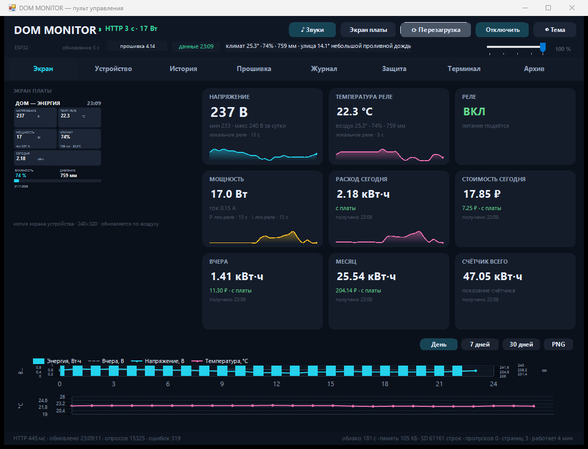

**Зачем она нужна.** На экране платы 240×320: цифры видно, а график только в
миниатюре. В программе те же данные, но крупно — графики за сутки и период,
история по дням, климат, архив, терминал, прошивка. Плата при этом продолжает
работать сама — программа это пульт, а не обязательная часть системы.

### Вкладки

| Вкладка | Что показывает |
|---|---|
| **Экран** | рисуемая копия интерфейса платы 240×320 + карточки с показателями и график за сутки; у каждого показателя — источник и возраст («локальное реле · N с») |
| **Устройство** | свойства платы (источник данных, COM-порт, адрес, прошивка, память, карта, тариф), смена порта и адреса, «Мастер настройки» |
| **История** | выбор дня ‹ ›, таблица 24 часов + ИТОГО, график (энергия/напряжение/температура), выбор часа кликом, пропуски, «Отчёт в Telegram», «CSV дня» |
| **Архив** | статус задачи `DomEnergy-DailyArchive`, последняя проверенная копия SD, путь, свободное место, «Снимок сейчас», «Тест восстановления», обезличенный отчёт |
| **Терминал** | «что плата делает сейчас» (`blk`, `blkMs`, `loopMaxAll`, `sdMs`, `histMs`, `heap`, `cTry/cOk/cFail`, `gapN`), `/vlog`, `/clog` с расшифровкой, `/files`, `/boots`, `/gapfill/status`, полный `/data` |
| **Прошивка** | сборка и заливка прошивки (папка со скетчем + `min_spiffs`, OTA с манифестом и проверкой) |
| **Журнал** | подробный лог: источник данных, время ответа, состояние облака и карты, ошибки |
| **Защита / Планировщик / Звуки** | те же настройки, что в вебе; сохраняются в плату |

### Графики

С 4.14 графики приложения построены на `System.Windows.Forms.DataVisualization.Charting`
(входит в .NET 4.8): энергия — столбиками, напряжение — линией, температура —
отдельной полосой. Есть подсказка сразу по трём значениям, сравнение с прошлым
днём, приход и расход по отдельности (день/ночь), переключатель
«День · 7 дней · 30 дней» и экспорт PNG. 366 дней считаются порядка 0,2 с.

### Telegram-пинг

`pc/DomTelegramPing.ps1` слушает Telegram и по слову **«пинг»** (а также
«ping», `/status`, «статус») присылает состояние платы: сборка, uptime,
память, LAN, облако, V/P/I/T с возрастом, энергия и деньги, тариф, карта,
пропуски, последняя загрузка.

- **только чтение**: управляющих команд у бота нет;
- отвечает только в один привязанный личный чат, чужие чаты игнорируются;
- токен — в `%APPDATA%\DomMonitor\tg-ping-config.json`, **не в репозитории**;
- работает только при включённом ПК и доступном Telegram;
- `tg-ping.log` — лог с ротацией, backoff при недоступном Telegram.

### Кнопки

| Кнопка | Что делает | Когда нужна |
|---|---|---|
| **Экран платы** | включает/выключает подсветку экрана платы (команда `disp` по serial) | на ночь, чтобы не светило; при выключении остаётся светодиод |
| **Перезагрузить** | перезагружает плату (команда `reboot` по serial, с подтверждением) | если плата зависла или после смены настроек |
| **Отключить / Подключить** | открывает/закрывает COM-порт | COM нужен только для команд «Экран платы» и «Перезагрузить»; данные идут по Wi-Fi |
| **‹ ›** (История) | предыдущий / следующий день | посмотреть прошлые сутки |
| **Сегодня** (История) | вернуться к текущей дате | после просмотра архива |
| **Обновить** (История) | перезапросить историю выбранного дня | если день открыт давно |
| **Отчёт в Telegram** (История) | отправляет отчёт за выбранный день | когда нужна сводка за день |
| **CSV дня** (История) | сохраняет историю дня в файл | для Excel или архива |
| **Применить** (Устройство) | запоминает выбранный COM-порт | сменили USB-адаптер |
| **Список** (Устройство) | перечитывает список COM-портов системы | плату только что подключили |
| **Сменить адрес** (Устройство) | меняет IP-адрес платы, по которому идут данные | переехали в другую сеть |
| **Мастер настройки** (Устройство) | пошаговая настройка: поиск платы, прошивка, Wi-Fi | при первом запуске или смене Wi-Fi |
| **ПРОШИТЬ** (Прошивка) | собирает и заливает прошивку | обновление версии |
| **Только собрать** (Прошивка) | компилирует без заливки | проверить, что скетч собирается |
| **…** (Прошивка) | выбрать папку скетча | другой проект |
| **Очистить** (Журнал) | чистит окно лога (файл не трогает) | стало шумно |

### Показатели: что это и как посчитано

У карточек с мини-графиком (напряжение, мощность, температура, расход) есть
подсказка при наведении, а щелчок открывает «Историю» с этим показателем.
Подробно про каждый:

| Показатель | Что это | Как считается | Зачем |
|---|---|---|---|
| **Напряжение** | напряжение в сети, В | от реле Tuya: локальный протокол (DP 6) или облако (`phase_a`); плата отдаёт его в `/data` как `v` | следить за качеством сети: норма 207–253 В по ГОСТ 32144-2013; при выходе — риск для техники |
| **Температура реле** | температура **корпуса** реле, °C | от реле (`temp_current`), это не воздух в комнате | перегрев реле = риск пожара; норма до 55 °C |
| **Реле** | включено реле или нет | состояние из `/data` (`r`) | понять, почему нет мощности при живом напряжении |
| **Мощность** | текущая нагрузка, Вт | поле `p` от реле (`phase_a`: напряжение × ток) | видеть, что включено и сколько потребляет |
| **Ток** | сила тока, А | из `phase_a` реле; вторая строка карточки «Мощность» | проверка: мощность = напряжение × ток |
| **Расход сегодня, кВт·ч** | сколько накрутило с 00:00 | разница счётчика энергии от начала суток (`tkwh`) | контроль дневного расхода |
| **Стоимость сегодня, ₽** | сколько это стоит | расход × тариф, считает плата (`tcost`) | понимать, во что обходится |
| **Вчера** | расход и стоимость за прошлые сутки | из истории платы (`ykwh`, `ykost`) | сравнение с сегодня |
| **Месяц** | с начала месяца | база счётчика на 1-е число + расход (`mkwh`) | контроль месячного счёта |
| **Счётчик всего, кВт·ч** | показание счётчика реле | напрямую от реле (`e`) | сверка с квитанцией |
| **Средняя мощность за час** | средняя за час, Вт | сумма всех записей часа / их количество (`p` в `/history?date=`) | видеть профиль дня |
| **Пик мощности за час** | максимальная мощность в часе, Вт | максимум из записей часа каждые 30 с (`pmax`) | ловить короткие включения (чайник, инструмент) |
| **Время пика** | когда случился пик, ЧЧ:ММ | момент максимальной записи часа (`pmaxT`) | связать всплеск с событием: чайник, насос, сварка |
| **Длительность пика** | сколько час был ≥80 % от пика, минуты | гистограмма мощности часа, сумма секунд в корзинах ≥80 % (`pmaxDur` — секунды) | отличить короткий импульс от долгой нагрузки |
| **«получено 12:31»** | когда последний раз приходили данные | отметка времени получения последнего значения, у каждой карточки своя | понять, какой источник отвалился: облако (напряжение) или реле (температура, счётчик) |
| **Тариф** | текущая цена кВт·ч | 8.39 ₽ день (06–23), 4.49 ₽ ночь (23–06); приходит от платы (`tariff`), виден в подписи «Стоимость сегодня» | считать стоимость правильно |
| **Пропуски** | часы без данных | плата считает по журналу (`gaps`, `gapMin`); в «Истории» — «пропусков нет» или «часов без записей N» | честно видеть, где данных нет |
| **cos φ** | коэффициент мощности | приходит от реле; показывается на веб-странице платы, в окне программы не выводится | 1.0 — активная нагрузка, ниже — реактивная (насос, компрессор, импульсный блок питания) |

### История за день

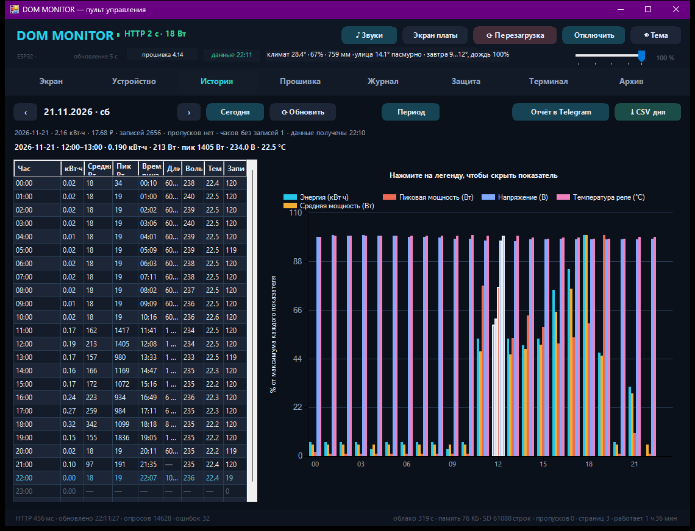

Слева — таблица 24 часов: кВт·ч, средняя и пик мощности, вольты, температура,
число записей; внизу ИТОГО. Справа — график, показатель выбирается щелчком по
карточке на вкладке «Экран». Наведение на столбик показывает всё сразу:
«16:00–17:00 · 0.15 кВт·ч · средняя 144 Вт · пик 144 Вт · 112 записей».

Неполный час виден честно:

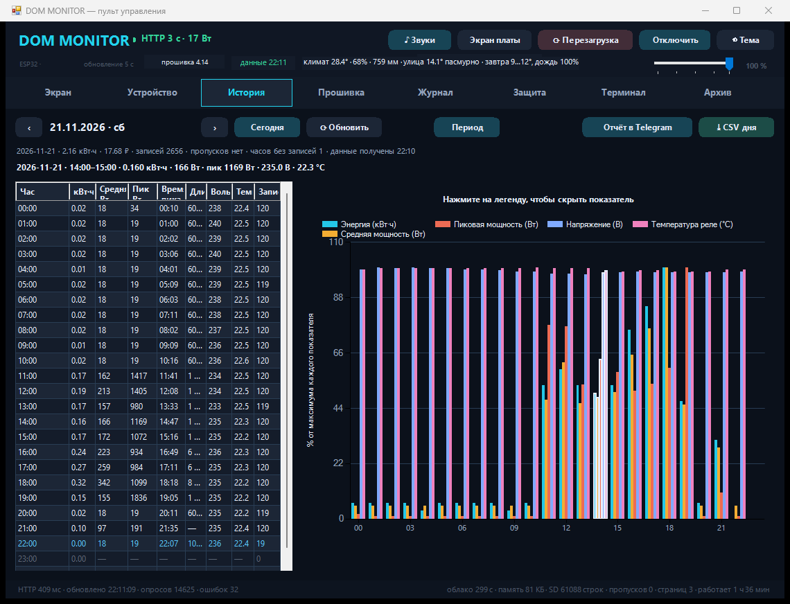

«17:00–18:00 (час не закончился) · 68 записей» вместо обычных ~112: столбик ниже
не потому, что расход упал, а потому что день ещё идёт. В подписи дня при этом
считаются пропуски: «пропусков нет · часов без записей 6» — это вечерние часы,
которых пока нет.

### Журнал

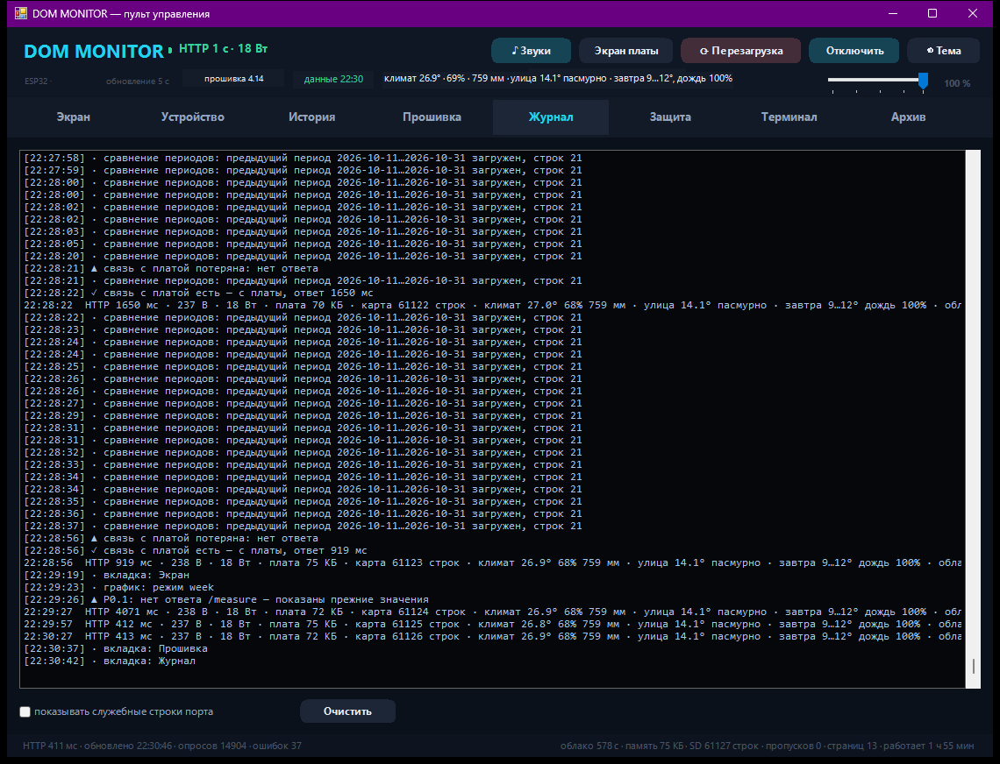

Источник данных (`HTTP` или `serial`), время ответа, память платы, строки на
карте, сколько данных в облаке и когда оно отвечало в последний раз, ошибки
опроса. Чекбокс «показывать служебные строки порта» добавляет сырой обмен по COM.

### COM-порт: три состояния


Сверху — порт открыт этой программой («открыт (монитор)», кнопка «Отключить»),
снизу — порт занят другой программой («занят другой программой», кнопка
«Подключить»). Третье состояние — «закрыт (свободен)». Данные идут по Wi-Fi,
поэтому порт нужен только для команд.

### Мастер настройки


Шаг 1 из 5: перебирает COM-порты и отличает нашу плату (CH340, VID `1A86`) от
ESP32-C3 (VID `303A`). Дальше — прошивка, Wi-Fi, проверка адреса; подробно в
разделе [«Установка»](#-установка).

### Как это работает

- приложение опрашивает плату по HTTP `http://192.168.1.51/data` раз в 3 секунды
  и `/measure` (источник/возраст) — не чаще 5 с;
- историю берёт из `/history?date=YYYY-MM-DD`, список дней — из `/days`,
  климат за период — из `/climatehist`, архив — из `DomEnergy-DailyArchive`;
- адрес платы и COM-порт хранятся в `%APPDATA%\DomMonitor\settings.json`, меняются на вкладке «Устройство»;
- serial (COM5) — только резерв и команды `disp`/`reboot`; если порт занят, программа продолжает работать по HTTP;
- если плата недоступна — «НЕТ СВЯЗИ», карточки с прочерком, программа не падает и сама восстанавливается, когда плата вернётся;
- управляющие запросы (в т. ч. OTA) подписываются ключом `X-Dom-Key` из `%APPDATA%\DomMonitor\control.key`;
- в подвале окна видно, сколько было опросов, сколько ошибок и когда данные обновились последний раз.

---

## ☁ Восстановление истории из облака

Две команды закрывают пропуски в истории. Обе работают на самой плате.

### `GAPFILL` — пропуски

Плата перезагружалась, теряла Wi-Fi, была выключена — в истории дырки. **GAPFILL
находит их и дописывает из облака.** Запускается вручную (командой, из веба кнопкой
«Заполнить пропуски» или из приложения) и **автоматически раз в сутки в 02:00**.

```text
GAPFILL                        последние 2 суток
GAPFILL 7                      последние 7 дней (предел облака)
GAPFILL 2026-11-01 2026-11-07  точный диапазон дат
GAPFILL LIST                   только показать, ничего не писать
/gapfill?run=1&from=&to=       то же по HTTP (кнопки в вебе и приложении)
```

- заполняет пропуски **больше 2 минут**, свежие (моложе 5 минут) не трогает
- вставляет строки каждые ~16 секунд с меткой `cost=0.00`
- реле: мощность 0 → реле 0, иначе 1
- **запускается автоматически через минуту после старта**

### `PWRHIST` — мощность

До версии 4.3 колонка мощности бралась из локального датчика и могла содержать
устаревшие значения (19 Вт при работающем приборе). `PWRHIST` перезаписывает её
почасовыми средними из облака. **Колонка энергии не трогается** — она из счётчика и всегда верна.

```text
PWRHIST                       последние 7 дней
PWRHIST 2026-10-23 2026-10-29
PWRHIST 23 29
```

### Что это дало на практике

Пример живой сверки: за 30.10 нашёлся скачок напряжения 241 → **242 В**, за
29.10 пик мощности в 18:00 вырос с 72 до **145 Вт**, а час 11 — с 20/146 до
**322/1833 Вт**. Энергия при этом не меняется: 29.10 осталось 2,12 кВт·ч.

Обе команды пишут файл безопасно: `.bak → .tmp → проверки → .old → замена`.
При любом сбое `/energy.csv` остаётся нетронутым. Откат — `/gapfill?undo=1`.

---

## 🔒 Какие данные публикуются, а какие нет

Коротко: **код и описание — да; ключи, пароли, адреса и история — нет.**
Полная версия — [docs/DATA-POLICY.md](docs/DATA-POLICY.md).

### Публикуется

| Что | Где |
|---|---|
| Исходный код прошивки | `firmware/cydv4/cydv4.ino` |
| Шрифт и веб-страница | `firmware/cydv4/font5x7.h`, `web/page.html` |
| Настройка TFT | `firmware/hw/User_Setup.h` |
| Схема данных, формат CSV | этот README, `docs/` |
| Скриншоты интерфейса | `docs/screenshots/` |
| Скрипты ПК | `pc/` |

### НЕ публикуется

- пароль и имя Wi-Fi;
- Tuya Device ID, Local Key, Client ID, Client Secret;
- ключ управления `X-Dom-Key` (`control-secret.h`, `control.key`);
- токен Telegram-бота (`tg-ping-config.json`, `settings.json`);
- IP-адреса реле, платы, компьютера;
- координаты города и ключ `OWM_KEY`;
- история потребления (`energy.csv`, бэкапы, PRIVATE-архивы);
- полный дамп flash/NVS;
- сборки `.bin/.elf/.map`, `*.manifest.json`.

Всё личное вынесено в `firmware/cydv4/secrets.h` и `control-secret.h`,
которых в репозитории нет. Шаблон ключей —
[`secrets.example.h`](firmware/cydv4/secrets.example.h). Оба файла уже в
`.gitignore`.

### Что уходит в облако Tuya

Плата обращается к `openapi.tuyaeu.com` (HTTPS), только если есть интернет:

- `client_id`, подпись HMAC-SHA256, время, токен;
- Device ID в пути запроса;
- получает `total_forward_energy`, `phase_a`, `temp_current`, `switch`;
- для дозаполнения истории — почасовые записи за пропущенные часы.

Облако видит историю потребления устройства — это его штатная функция.
Пароль Wi-Fi и Local Key в облако **не уходят**.

### Что остаётся локально

- история на microSD;
- веб-страница (только LAN);
- serial/USB;
- бэкапы на вашем диске/NAS;
- ключи в `secrets.h` и NVS.

### Что уходит в OpenWeatherMap

Два HTTPS-запроса с координатами и ключом `OWM_KEY`:

```
https://api.openweathermap.org/data/2.5/weather?lat=…&lon=…
https://api.openweathermap.org/data/2.5/forecast?lat=…&lon=…
```

Ни ключей Tuya, ни истории, ни device id. Если погода не нужна, не заполняйте
`OWM_KEY` — экран покажет «НЕТ ДАННЫХ». Состояние обоих запросов видно по
HTTP: `/weather` и `/forecast`.

### Ключ управления и Telegram

- **`X-Dom-Key`** — не публикуется: лежит в `control-secret.h` и
  `%APPDATA%\DomMonitor\control.key`, в репозиторий и архивы не попадает.
  В идентификатор сборки (`build_identity.h`) секреты не включаются.
- **Telegram-пинг** — токен в `%APPDATA%\DomMonitor\tg-ping-config.json`,
  бот только читает состояние платы, управляющих команд нет. В ответ
  не попадают токен платы, device id и MAC.
- **Обезличенный отчёт** (веб и приложение) — без IP, MAC, SSID, токенов,
  device id и сырых измерений. Полные PRIVATE-архивы устройства содержат
  flash, NVS и токены и **не публикуются**.

### Формат строки на SD

```csv
datetime,voltage,power,energy_kwh,relay,cost,temp
2026-10-30 14:33:07,236,152.0,19.04,1,10.39,22.1
```

| Поле | Что | Единица |
|---|---|---|
| `datetime` | локальное время платы | `YYYY-MM-DD HH:MM:SS` |
| `voltage` | напряжение | В |
| `power` | мощность на момент записи | Вт |
| `energy_kwh` | накопленный счётчик реле | кВт·ч |
| `relay` | реле | `1` / `0` |
| `cost` | накопленная стоимость с начала месяца | ₽ |
| `temp` | температура корпуса реле | °C |

Пишется не чаще раза в 30 секунд; без напряжения/времени/счётчика строка
не пишется. В конце месяца файл уходит в `/energy-YYYY-MM.csv`.

### Как получить ключи Tuya

Подробная инструкция со скриншотами шагов — [docs/TUYA-KEYS.md](docs/TUYA-KEYS.md):
регистрация на iot.tuya.com, Cloud-проект, привязка приложения по QR,
и главное — команда API, которая отдаёт `local_key`.

### Как настроить свои ключи

```powershell
cd firmware\cydv4
copy secrets.example.h secrets.h
notepad secrets.h
```

```cpp
#define WIFI_SSID      "ваша_сеть"
#define WIFI_PASS      "ваш_пароль"
#define TUYA_DEVICE_ID "..."
#define TUYA_LOCAL_KEY "..."
#define TUYA_CLIENT_ID "..."
#define TUYA_SECRET    "..."
#define RELAY_IP       "192.168.1.25"
#define PC_API_URL     "http://192.168.1.20:8090"
#define WEATHER_LAT    "YOUR_LAT"
#define WEATHER_LON    "YOUR_LON"
#define OWM_KEY        "ваш_ключ_OpenWeatherMap"
```

Проверка перед публикацией:

```powershell
git status --short
git grep -n "WIFI_PASS\|TUYA_SECRET\|LOCAL_KEY" -- . ":(exclude)firmware/cydv4/secrets.example.h"
```

Если в выводе реальные значения — не коммитьте.

---

## 🚀 Быстрый старт

### 1. Клонировать

```powershell
git clone https://YOUR-GIT-SERVER:3000/admin/dom-energy.git
cd dom-energy
```

### 2. Создать `secrets.h` и ключ управления

```powershell
cd firmware\cydv4
copy secrets.example.h secrets.h
notepad secrets.h
```

Заполните Wi-Fi (2,4 ГГц), ключи Tuya, IP реле. Если PC-сервера нет —
`PC_API_URL ""` (это необязательный сервер на ПК, его код в репозиторий не
входит). Погода — `OWM_KEY` и координаты; без ключа плата работает, просто
без погоды.

Затем ключ управления (он же `X-Dom-Key`):

```powershell
# любая случайная строка без пробелов
"#define DOM_CONTROL_TOKEN ""ваш_ключ""" | Set-Content control-secret.h -Encoding utf8
New-Item -ItemType Directory -Force "$env:APPDATA\DomMonitor" | Out-Null
Set-Content "$env:APPDATA\DomMonitor\control.key" "ваш_ключ" -NoNewline
```

Оба файла — **не в git**: `control-secret.h` и `settings.json` уже в
`.gitignore`. Без ключа плата работает, но управление закрыто (HTTP 503).

### 3. Поставить инструменты и настроить экран

```powershell
arduino-cli core install esp32:esp32@2.0.9
arduino-cli lib install TFT_eSPI@2.5.44
arduino-cli lib install ArduinoJson@7.4.3 PubSubClient@2.8

copy firmware\hw\User_Setup.h `
  "$env:USERPROFILE\Documents\Arduino\libraries\TFT_eSPI\User_Setup.h" -Force

cd firmware\cydv4
python web\build_page.py
cd ..\..
```

`User_Setup.h` обязателен: он лежит **вне скетча**, в библиотеке. Без него
экран будет чёрным. `build_page.py` пересобирает `page_html.h` и `assets.h`
(19 плейсхолдеров, лимиты размеров).

### 4. Собрать и прошить

```powershell
$cli = "C:\Program Files\Arduino CLI\arduino-cli.exe"

& $cli compile `
  --fqbn "esp32:esp32:esp32:PartitionScheme=min_spiffs" `
  --libraries "$env:USERPROFILE\Documents\Arduino\libraries" `
  --build-path "build" `
  "firmware\cydv4"

& $cli upload `
  -p COM5 `
  --fqbn "esp32:esp32:esp32:PartitionScheme=min_spiffs" `
  --upload-property "upload.speed=921600" `
  --input-dir "build" `
  "firmware\cydv4"
```

Подробно, с ошибками и проверками — [BUILD.md](BUILD.md).
Восстановление после поломки — [RESTORE.md](RESTORE.md).

---

## 📁 Структура репозитория

```
dom-energy/
├── README.md                     этот файл
├── LICENSE                       MIT, 2026
├── BUILD.md                      сборка и прошивка CYD
├── RESTORE.md                    восстановление устройства
├── CHANGELOG.md                  история версий (4.14 сверху)
├── .gitignore                    секреты, сборка, данные
├── docs/
│   ├── README.md                 индекс документации
│   ├── RELEASE-4.14.md           описание выпуска 4.14
│   ├── АРХИТЕКТУРА.md            как устроено внутри
│   ├── DATA-POLICY.md            политика данных
│   └── screenshots/              board, web, pc; кадры 4.14 — в 4.14/
├── firmware/
│   ├── cydv4/
│   │   ├── cydv4.ino             прошивка (без секретов)
│   │   ├── page_html.h           страница (генерируется)
│   │   ├── assets.h              css/js-ресурсы (генерируется)
│   │   ├── build_identity.h      идентификатор сборки (генерируется)
│   │   ├── meas_sources.h        источник/возраст/TTL, /measure
│   │   ├── bounded_web_server.h  дедлайны отправки, X-Dom-Key
│   │   ├── range_reader.h        /range порциями (202/pending)
│   │   ├── archive_transaction.h ротация без удаления истории
│   │   ├── runtime_time.h        единый взгляд на время
│   │   ├── trusted_roots.h       CA Tuya и OpenWeatherMap
│   │   ├── font5x7.h, secrets.example.h
│   │   └── web/
│   │       ├── page.html         исходник страницы
│   │       ├── app.js, app.css, history.js, control.js
│   │       └── build_page.py     собирает page_html.h и assets.h
│   └── hw/
│       └── User_Setup.h          настройка TFT_eSPI
├── pc/
│   ├── DomMonitor.ps1 + .exe     GUI и лончер без консоли
│   ├── DomMonitor-run.ps1        супервизор: приложение + Telegram-пинг
│   ├── DomTelegramPing.ps1       пинг-бот (только чтение)
│   ├── ControlAuth.ps1           ключ X-Dom-Key
│   ├── MetricHistory.ps1         история показателей
│   ├── archive-run.ps1, archive-sd.py   проверяемый архив SD
│   ├── flash-http.ps1            OTA с манифестом
│   ├── restore-board.ps1         восстановление платы
│   ├── backup-sd.py, backup-firmware.py
│   └── README-EXE.md             про единый EXE
└── tests/
    ├── test-board.py             сквозные тесты (24/24 (`--quick`; полный прогон 26/26))
    ├── review-*.py / *.ps1       стенды проверок
    └── README.md                 как запускать
```

---

## ✅ Тесты

`tests/test-board.py` проверяет живую плату по HTTP: доступность, `/measure`,
`/storage`, `/climatehist`, физические границы, целостность CSV, сходимость
мощности со счётчиком, математику «сегодня/вчера», стоимость, прогноз и
стабильность. Ориентир на 4.14 — **24/24 (`--quick`; полный прогон 26/26)**, 0 ошибок.

```powershell
$env:BOARD_URL = "http://192.168.1.51"   # ваш IP платы
python tests\test-board.py
```

Быстро:

```powershell
python tests\test-board.py --quick
```

Кроме сквозного теста есть отдельные стенды (работают офлайн или против
платы): `review-climatehist.py`, `review-web-stress.py`,
`review-boot-recovery.ps1`, `review-gap-commit.ps1`,
`review-telegram-ping.py` и офлайн-фикстуры `_p14_*.ps1`. Что именно
проверяется и как читать вывод — [tests/README.md](tests/README.md).

---

## ⚠ Ограничения

- **Wi-Fi только 2,4 ГГц**, мощность передатчика 11 dBm.
- **Смены Wi-Fi с экрана нет**: сеть задаётся либо в `secrets.h`, либо командой
  `WIFISET` по serial (её отправляет мастер настройки). Экран «НАСТРОЙКИ»
  (с 4.13) меняет скин, яркость, звук и тихие часы, но не сеть.
- **Управление закрыто ключом `X-Dom-Key`**; без ключа в прошивке — HTTP 503.
  Чтение данных в LAN открыто, у страницы нет пароля.
- **HTTP внутри LAN не шифрует трафик** — порт платы не публиковать в интернет.
- **TLS облака и погоды по-прежнему в `loop()`**: возможны всплески цикла
  1,5–3 с; вынос TLS в отдельную задачу не сделан (нужен стенд).
- **Редкие обрывы больших ответов** под патологической нагрузкой
  (8 параллельных потоков загрузки страницы); обычная — 20 из 20 целиком.
- **Нет отдельного DP мощности**; локальный DP 6 может отставать — это видно
  по `source`/`ageSec` в `/measure`. Облако свежее, но требует интернета.
- **Калибровка тача — только serial** (`CALTOUCH`).
- История не пишется без времени и без напряжения — это защита, а не баг.
- Экран «СТОРОЖ» в коде есть, но отключён (`wdTick()` не вызывается,
  `WD_UI 0`). В интерфейсе его нет.
- **Облако Tuya хранит историю 7 суток.** Пропуски старше недели `GAPFILL` не заполнит —
  только покажет пометкой.
- **История климата** для `/climatehist` читается из хвоста `/climate.csv`
  (до 400 дней); при `partial:true` самые старые дни могут не попасть в ответ.
- **Telegram-пинг** работает только при включённом ПК и доступном Telegram;
  бот умеет только читать.
- **Причина паники 16.11 не доказана**; `/shot` в обычной сборке выключен,
  для диагностики — `/stage` и `/boots.log`.
- **`WIFISET` подключается до 20 секунд**; если сеть не отвечает — откат ещё 15 секунд.
  Сделано неблокирующим, интерфейс при этом работает.
- **Пик часа и его длительность считаются по записям** (раз в 30 секунд).
  Если нагрузка короткая и попала между записями, пик может быть занижен,
  а длительность — округлена.
- `history.js` — 63 122 Б при лимите 64 512: новый код кладём в `app.js`
  или `page.html`.

---

## 🔗 Мы в Threads

История сборки и обновления — в Threads: [пост о плате](https://www.threads.com/@nika.service/post/DfVcBmNCGNq).


## 👤 Разработчик

**Александр Смелков** (Alexander Smelkov)

| | |
|---|---|
| Компания | NIKA SERVICE |
| Сайт | [nika-sc.ru](https://nika-sc.ru) |
| Город | Сочи, Россия |
| GitHub | [@nika-sc](https://github.com/nika-sc) |
| Профиль | Программирование для медицинских приложений и сервисов |

Проект вырос из практической задачи: нужно было видеть, **когда** и **сколько**
потребляет дом, а не только итоговую сумму в квитанции. Всё, что здесь есть —
сделано и проверено на живом устройстве: с 30.10.2026 непрерывный учёт,
**больше 61 000 строк истории** (на 21.11.2026), десятки найденных и
исправленных ошибок.

Отдельная благодарность за терпение и подробные отчёты об ошибках —
без них половина этих исправлений не появилась бы.

### Связанные проекты

- [Nika Service CRM](https://github.com/nika-sc/Nika_Service_CRM) — CRM для сервисного центра

---

## 🤝 Как помочь проекту

Проект открыт, и любая помощь полезна:

| Что | Как |
|---|---|
| Нашли ошибку | Issue в трекере репозитория — с логами и версией прошивки |
| Есть идея | Issue с меткой `idea` или обсуждение в трекере |
| Сделали улучшение | Pull request — с описанием, что и зачем |
| Собрали такой же | Поделитесь фотографией и отзывом в issue |

**Что особенно пригодится:**
- проверка на других моделях реле Tuya (не только `Breaker`, категория `dlq`)
- проверка на платах CYD с ёмкостным экраном
- переводы README на другие языки
- сообщения о расхождениях с облаком Tuya


---


## Поддержать проект

[](DONATE.md)

Проект бесплатный и открытый (MIT). Платы, компоненты и время на разработку оплачиваются автором — буду благодарен любой сумме.

**Т-Банк:** `2200 7006 5243 7038` · **Telegram:** [8 (938) 418-59-40](https://t.me/+79384185940) · **Email:** nika-sc@bk.ru


## 📄 Лицензия

MIT, 2026. См. [LICENSE](LICENSE).

Проект учебно-практический: он не заменяет заводской счётчик и не даёт
юридически значимых показаний. Реле и электрическую часть выбирайте под
свою нагрузку; при сомнениях — электрик.
